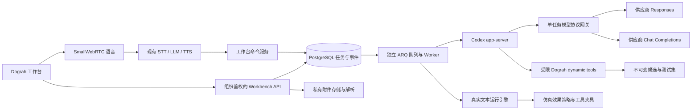

本文对应 `codex/agent-workbench-mvp` 分支。目标是让你的用户在一个工作台里完成 Agent 构建、文本仿真和调优，同时继续使用 Dograh 原有编辑、版本、电话和语音测试功能。实现使用真实 Codex app-server；离线原型仍在 `ui/public/prototypes/agent-workbench/`，不代表真实服务的执行结果。

## 1. 范围与关键决策

| 决策 | MVP 实现 |
| --- | --- |
| 界面 | 原生 Dograh 导航，流程画布 / 文本仿真 / 调优记录，右侧构建助手；没有 Journey |
| 构建执行器 | 独立 ARQ Worker 启动开源 Codex app-server，每个任务使用独立临时 CODEX_HOME |
| 模型 | 复用当前组织的 Dograh Models / Provider Connections，包含 Qwen 等 OpenAI 兼容模型 |
| 构建协议 | 会话配置 `model_protocol=chat\|responses`；界面可选，运行中的任务禁止切换 |
| 工具接入 | Codex dynamic tools 直接调用 Dograh 服务；不经过 Dograh MCP 的 HTTP 认证和传输层 |
| 附件 | 私有对象存储、本地受限解析进程；支持上传、拖放、粘贴和已有附件复选 |
| 仿真 | 固定用户脚本 + 真实 Pipecat 文本引擎 + 确定性断言；外部业务效果使用显式夹具 |
| 调优 | 冻结候选基线和测试集，Codex 修改后重跑；只推荐有改善且无通过用例回退的结果 |
| 实时语音 | Dograh SmallWebRTC → 现有 STT → LLM → TTS；语音工具调用同一工作台命令服务 |
| 生效 | 不可变候选 → 用户应用到草稿 → 原编辑器审核与发布 |
| 回退 | `AGENT_WORKBENCH_ENABLED=false` 保留原 Agent Builder / MPS 模板生成入口 |

你引用的[规划 Codex 自动构建 Agent (2)](codex://threads/01a14390-99c4-7103-b6fd-b2de3ab1606b)指出，MPS 还承担托管模型、知识库文件处理、录音转写、语音目录、配额和账单等职责。这次只替换 Agent Builder 的生成路径，不删除这些依赖，也不改变已有的 Dograh MCP 和服务密钥体系。

## 2. 架构与协议选择



### 2.1 Codex 与模型是两个配置层

Codex 是规划与工具执行器，Qwen 是它调用的模型。当前 Codex app-server 通过 Responses 协议访问一个只监听 `127.0.0.1` 的任务专属网关，网关根据会话配置选择上游协议：

- **responses**：访问已配置 `base_url + /responses`，保留函数调用与结果语义，限制为本任务工具白名单，关闭服务端存储。
- **chat**：将 Responses 消息转换成 Chat Completions，访问 `base_url + /chat/completions`，把 `tool_calls` / `tool_call_id` 转换回 Responses；`developer` 角色映射为 `system`。
- 两种模式都保持相同的配置模型、连接密钥和工具权限；不会因接口失败静默换协议或换模型。
- 当前提供的 `qwen3.6-27b` 已在 Chat 路径实测成功；其当前地址的 Responses 请求返回不支持该模型。Responses 路径已做契约测试，实际供应商联调需要选择支持 Responses 的模型。
- MVP 上游请求暂为非流式，完成后向 Codex 发出 Responses SSE 事件。界面显示任务/工具/消息事件，不承诺逐 token 展示。
- 此配置只控制 **Codex 构建和调优** 的模型接口。仿真和实时语音仍走 Dograh 服务工厂及相应模型连接。

API 请求示例：

```json
{"name":"预约助手","model_protocol":"chat"}
```

切换已有会话使用 PATCH `/api/v1/agent-workbench/sessions/{session_id}`：

```json
{"model_protocol":"responses"}
```

当前实现要求构建 LLM 是 OpenAI 兼容连接。不要把个人 Codex 登录目录挂载给用户任务。供应商 API 密钥只在网关进程内存里使用；Codex 子进程只收到临时的本地网关令牌。

### 2.2 为什么先不经过 MCP

工作台、Worker 和 Dograh 后端属于同一应用，直接调用领域服务可以共享组织身份、取消租约、校验器和数据库事务，减少 MCP 服务密钥与网络连接管理。复用 `api/mcp_server/ts_bridge.py` 的 SDK/AST 解析器并不意味着通过 MCP 传输。

对外 Dograh MCP 保留。以后需要外部 Codex 客户端操作工作台时，可以给同一服务加 MCP 适配层，暴露 `create_session`、`submit_instruction`、`get_status`、`run_evaluation`、`tune`、`cancel` 等能力。MVP 没有新增对外 MCP 工具；不能把“协议设计”当作已上线接口。

## 3. 用户界面与完整流程

### 3.1 构建

1. 新建 Agent 进入工作台；已有 Agent 在原编辑器菜单打开工作台。
2. 后端创建组织归属的会话。新 Agent 只有空草稿，不自动生成已发布版本。
3. 用户选择当前草稿或已有候选作为修改起点，再输入目标，可选最多 5 个已经解析完成的附件，也可以使用实时语音描述目标。
4. API 校验组织、附件状态、请求幂等键和会话并发状态，写入任务及 `task.queued` 事件。
5. Worker 获取 60 秒租约，每 10 秒续租。读取当前草稿完整指纹、组织模型配置与附件清单。
6. Codex 读取上下文和节点规格，通过 `@dograh/sdk` 生成 TypeScript。
7. AST 解析器只接受声明式 SDK 子集；不执行模型生成的 JavaScript。校验真实图结构、触发路径、工具名称冲突及引用资源的组织归属。
8. 保存不可变候选和测试集。任务成功必须有真实保存结果，不以模型声称完成为依据。
9. 页面通过事件游标和状态轮询恢复进度，显示流程、代码、摘要和可执行测试集。

### 3.2 附件

允许 TXT、MD、CSV、JSON、PDF、DOCX、XLSX、PNG、JPEG、WebP。单文件最大 20 MiB，每条指令最多引用 5 个附件。附件绑定组织和会话，读取工具只能读取本任务选择的附件。

| 格式 | 解析与限制 |
| --- | --- |
| TXT / MD / JSON | UTF-8；JSON 结构化格式化；最多保留 200,000 个文本字符并标记截断 |
| CSV | 最多 5,000 行；超过限制报错 |
| PDF | 不加密、最多 200 页，按页提取；扫描件无文本时报错，不虚构 OCR 内容 |
| DOCX | 段落和表格；不执行宏 |
| XLSX | 只读、缓存值、不读取外部链接，最多 50,000 单元格；不计算公式 |
| 图片 | 验证格式和像素，最多 2,000 万像素；清除元数据并生成最多 768px 的模型输入，需视觉模型 |

Office ZIP 最多 5,000 个成员、解压大小 80 MiB，拒绝宏及加密文件。解析子进程使用最小环境，30 秒超时、20 秒 CPU 限制；Linux 额外设置 768 MiB 地址空间上限。图片解析不等于当前 Qwen 文本模型具备视觉能力；不支持图片的模型应返回明确失败，用户可改用视觉模型或文本说明。

附件用独立私有 bucket，不复用本地普通录音 bucket 的公开策略。对象键包含组织和会话；接口不返回公开 URL 或存储密钥。模型读取到的文档内容被视为业务数据，不能改变工具权限。MVP 解析在上传请求内完成，尚未实现独立解析队列、OCR、复杂版式还原和自动清理策略。

### 3.3 文本仿真

用户可以选择候选、编辑测试集并运行。每次编辑保存一个新的不可变测试集；已提交任务固定引用原测试集 ID。

每条用例包含：名称、固定用户消息、初始上下文、业务工具夹具、可选预取上下文与知识库结果、断言。支持：

- `contains` / `not_contains`：只检查 Agent 文本，不把用户话语作为命中。
- `node_visited`：检查真实运行引擎的节点迁移事件。
- `tool_called`：检查实际发生的夹具工具调用。
- `context_equals`：检查最终收集上下文。
- `completed`：检查对话是否完成。

仿真调用 `execute_text_chat_pending_turn`，每个用例持有独立运行记录、固定候选 definition 和逐轮 checkpoint。每套最多 20 条用例，每条最多 12 条用户消息，每轮 75 秒超时。保存逐轮文本、节点事件、工具调用、断言结果与模型用量。

**效果隔离发生在实际运行引擎内部**：打开 MCP 会话之前直接返回；HTTP/MCP 工具使用夹具；预通话 HTTP 预取改用 `pre_call_context`；知识库查询改用 `knowledge_result`；录音节点不支持时拒绝；不触发普通通话完成集成、账单或电话动作。缺少夹具、服务错误、超时都不能算通过。

MVP 的夹具 schema 由测试作者显式提供，不能证明线上工具 schema 或业务服务可用。结果分为 `passed`、`failed`、`error`、`inconclusive`。字面断言不是语义评分，更不是生产环境业务验收。

### 3.4 调优

1. 固定候选 ID、测试集 ID、当前任务解析出的模型配置。
2. 先运行基线，获得真实失败对话。
3. 将用户调优目标、冻结测试集和失败证据交给 Codex。调优工具集不提供 `save_suite`。
4. Codex 保存新候选，按相同测试集和同一任务模型配置重跑。
5. 接受条件：用例数相同、没有错误或无法判定、所有原先通过的用例仍通过、通过数严格增加。
6. 最多 3 轮；没有改善时保留原推荐候选。全部通过时停止，不进行无依据修改。
7. 候选仍需用户采纳到草稿；不会自动发布。

冻结的是测试集和本任务持有的模型配置对象；尚未实现供应商随机种子控制、跨任务完整配置重放或统计显著性分析。

### 3.5 实时语音交互

语音是工作台的输入与答复通道，用户可以说“根据这份附件构建”“运行测试”“根据失败结果调优”“取消任务”。

- 使用已有登录鉴权、组织模型连接、STT/TTS 服务工厂、SmallWebRTC 和 ICE/TURN 配置。
- 浏览器发送麦克风轨道；服务端 STT 形成完整话语，LLM 调用工作台工具，TTS 播报结果。
- 语音与文字共享会话、附件、当前候选/测试集选择及任务状态。
- 语音工具：`submit_instruction`、`get_status`、`run_tests`、`tune_agent`、`cancel_task`。
- 关闭语音或打断播报不取消后台任务；只有明确取消命令才取消任务。
- 每组织最多 2 路工作台语音，每路最多 10 分钟。连接断开释放轨道、连接及 Redis 配额。
- 工作台语音与原有“Test Agent / Test Audio”不同：前者控制构建过程，后者测试目标 Agent 的实际对话。两者保留。

## 4. 数据结构

新增 7 张表，复用 `workflow_definitions` 保存候选图：

| 表 / 字段 | 作用与约束 |
| --- | --- |
| `workbench_sessions` | UUID 主键；organization_id、user_id、workflow_id；model_protocol；event_sequence；创建时间 |
| `workbench_events` | `(session_id, sequence)` 联合主键；事件类型、JSON payload、创建时间；支持断线续读 |
| `workbench_jobs` | 会话、kind、status、input/output JSON、error、lease_token、lease_until；`(session_id, idempotency_key)` 唯一 |
| `workbench_assets` | 会话、文件名、MIME、大小、SHA-256、私有对象键、解析状态/结果/错误 |
| `workbench_candidates` | 会话、任务、definition_id、SDK code、name、summary、fingerprint、base_fingerprint；创建后不修改 |
| `workbench_suites` | 会话、payload、fingerprint；每次编辑创建新行 |
| `workbench_evaluations` | 会话、任务、候选、测试集、状态、results JSON、summary JSON；用例结果嵌入 JSON |
| `workflow_definitions.status=candidate` | 候选不进入普通发布历史、发布指针与普通运行选择 |
| `workflow_runs.purpose` | 新增默认 `normal`，仿真用 `evaluation`；普通列表、报表和完成任务排除仿真 |

迁移：`d17b90c4e201_agent_workbench.py`、`e18c90d4e202_workbench_model_protocol.py`。回滚会删除工作台数据，操作前需备份；功能回退优先关闭开关。

### 4.1 租户、并发与采用

所有接口从登录用户获取组织，所有子资源先验证组织所属会话。模型不接收可自行选择的 organization_id。每会话同时最多一个构建/评测/调优任务，每组织最多两个运行任务，Worker 总并发 4。

数据库充当持久任务队列入口，Redis/ARQ 负责调度；每 15 秒扫描未入队任务。租约失效后标记失败，用户可重新提交，不自动重复外部调用。取消立即改变数据库状态；所有后续候选、事件和评测写入必须通过租约令牌校验。Worker 最迟下一次续租发现取消并停止子任务。

采用候选在事务内锁定组织模型目录和目标 workflow，并对**名称、图、模型配置、模板变量**计算完整指纹。当前草稿与生成时基线不一致返回 409，不能覆盖用户并发编辑。从已有候选继续构建或调优时也检查基线；若草稿已另行修改，需选择“当前草稿”重新构建。采用只更新草稿和原有工作流兼容字段，不更新 `released_definition_id`。

## 5. HTTP、事件与内部工具接口

所有 HTTP 路径前缀为 `/api/v1/agent-workbench`，使用现有 Bearer 登录身份。

| 方法与路径 | 作用 |
| --- | --- |
| GET `/capabilities` | 功能开关、Codex 安装检测、附件限制 |
| POST `/sessions` | 新建或打开 Agent 的工作台 |
| GET `/sessions/{id}` | 当前草稿、候选、附件、任务、测试集、评测 |
| PATCH `/sessions/{id}` | 配置构建协议 |
| GET `/sessions/{id}/events?after=N` | 每次最多 200 条持久事件，序号递增 |
| POST `/sessions/{id}/instructions` | 提交构建/修改指令、附件 ID 和幂等键 |
| POST `/sessions/{id}/assets` | multipart 上传并解析 |
| POST `/sessions/{id}/assets/{asset}/retry` | 重试解析 |
| GET `/sessions/{id}/candidates/{candidate}` | 查看候选快照与代码 |
| POST `/sessions/{id}/suites` | 保存新的不可变测试集 |
| POST `/sessions/{id}/evaluations` | 提交仿真任务 |
| POST `/sessions/{id}/tune` | 提交固定测试集的调优任务 |
| POST `/sessions/{id}/jobs/{job}/cancel` | 幂等取消 |
| POST `/sessions/{id}/candidates/{candidate}/adopt` | 采用到草稿，检查冲突 |
| POST `/sessions/{id}/voice-tool` | 语音命令的同构 HTTP 入口 |
| WS `/sessions/{id}/voice` | 语音信令、上下文选择、转写、工具结果 |

事件包括 `task.queued/started/completed/failed/cancelled`、`codex.started`、`tool.started/failed`、`assistant.message`、`asset.uploaded/ready/failed`、`candidate.created/adopted`、`suite.created`、`evaluation.started/updated`、`voice.transcript`。界面每 2 秒同步状态；尚未实现服务端事件推送。

Codex 内部工具：

| 工具 | 输入和边界 |
| --- | --- |
| `get_context` | 脱敏 SDK 代码、组织工具/文档/凭据元数据、最近需求、当前附件清单 |
| `list_node_types` / `get_node_type` | 真实节点规格、字段和范例 |
| `read_attachment` | 已选择附件 ID、offset、limit；返回文本与来源位置 |
| `validate_candidate` | SDK code；AST 和实际图校验，不落库 |
| `save_candidate` | SDK code + summary；再次校验，保存不可变快照 |
| `save_suite` | 声明式 SimulationSuite；调优阶段不可用 |

模型网关剔除 shell、文件系统、网页搜索和未授权函数。工具白名单双向校验；每 Codex 运行最多 40 次模型请求、150,000 个累计 token、80 次工具调用，任务总预算 900 秒。模型错误只返回有限诊断，不透传供应商敏感响应。

## 6. 代码模块清单

| 模块 | 修改 |
| --- | --- |
| `api/schemas/agent_workbench.py` | 请求、测试集、语音工具的有界契约 |
| `api/routes/agent_workbench.py` / `routes/main.py` | 鉴权、开关、HTTP 与 WebSocket 路由 |
| `api/db/agent_workbench_client.py` / `db_client.py` / `models.py` | 组织查询、任务租约、候选、事件、原子采用与模型 |
| `api/services/agent_workbench/codex_client.py` | Codex JSON-RPC 进程生命周期、动态工具调度、取消清理 |
| `model_gateway.py` | 两种上游协议、凭据隔离、工具限制与用量预算 |
| `tools.py` | 节点发现、附件读取、SDK 校验、候选和测试集保存 |
| `attachments.py` / `file_parser.py` | 私有存储、格式校验、独立解析进程 |
| `jobs.py` / `api/tasks/agent_workbench.py` | 独立队列、outbox、构建/评测/调优状态机 |
| `evaluation.py` / `evaluation_policy.py` | 真实文本仿真、确定性断言、效果隔离 |
| `voice.py` / `voice_commands.py` | 现有语音栈与共享工作台命令 |
| `workflow/text_chat_runner.py` / `pipecat_engine*.py` | 服务端仿真策略扩展点，默认正常运行路径保持原行为 |
| `pipecat/service_factory.py` | DashScope Qwen 的非思考 Chat 参数和 developer 角色兼容 |
| `db/filters.py` / `reports_client.py` / `workflow*_client.py` | 普通列表、统计与报表排除仿真 |
| `tasks/workflow_completion.py` / `run_integrations.py` | 仿真运行禁止普通完成任务与集成 |
| `mcp_server/ts_bridge.py` | 取消时回收 AST 解析子进程 |
| `ui/src/components/agent-workbench/` | 工作台、附件交互、流程预览、测试/调优结果、WebRTC Hook |
| `ui/src/app/workflow/{create,workbench}` | 开关切换和工作台路由 |
| `WorkflowEditorHeader.tsx` / `AppLayout.tsx` | 原编辑器入口、工作台布局，保留其它菜单 |
| `ui/src/client/` | 从实际 OpenAPI 重新生成的 SDK |

## 7. 本地启动与部署要求

先按仓库贡献文档安装 Python、Node、PostgreSQL、Redis、对象存储和 pipecat 子模块依赖。工作台还需要可执行的 Codex app-server、已安装依赖的 `api/mcp_server/ts_validator`。本次使用 Codex `0.162.0-alpha.17.2` 完成联调，动态工具接口属于实验能力；部署应固定经验证版本，不自动升级。

后端环境配置：

```dotenv
AGENT_WORKBENCH_ENABLED=true
WORKBENCH_CODEX_BINARY=/absolute/path/to/codex
WORKBENCH_DATA_DIR=/private/workbench/runtime
WORKBENCH_ASSET_BUCKET=private-workbench-assets
```

该配置不需要 OpenAI API key。你在 Dograh Providers/Models 配置所用模型及 STT/TTS 后，工作台从组织/Agent 配置解析连接。本次本地验收使用 Qwen + ElevenLabs STT/TTS。模型密钥不可写进前端环境变量。

执行迁移并分别启动 API 和专用 Worker：

```bash
source venv/bin/activate
set -a
source api/.env
set +a
python -m alembic -c api/alembic.ini upgrade head
python -m uvicorn api.app:app --host 127.0.0.1 --port 8016
```

在另一个终端加载同一后端环境后：

```bash
python -m arq api.tasks.agent_workbench.WorkbenchWorkerSettings
```

前端 `.env` 的 `BACKEND_URL`、`NEXT_PUBLIC_BACKEND_URL` 指向该 API；在 `ui/` 执行：

```bash
npm run generate-client
npm run dev -- --port 3016
```

正式部署需要 HTTPS/WSS、正确的 ICE/TURN、私有 bucket 权限及容量管理。API 和 Worker 使用相同数据库、Redis、对象存储和应用加密配置；Worker 需要 Node AST 解析器和 Codex 二进制，普通语音 Worker 不承接工作台队列。此版本没有自动修改现有生产 compose，也没有验收 Linux 容器镜像。现有 WebSocket 登录沿用 token query 鉴权，访问日志应隐藏查询参数。

## 8. 验证记录与后续边界

2026-10-16，在独立本地 PostgreSQL / Redis / MinIO 环境中验证：

- 真实 Codex app-server → Chat 适配层 → 配置的 Qwen，成功调用 Dograh 动态工具并保存候选。
- 上传 Markdown 预约说明，完成私有存储、解析和 Codex 附件读取。
- Codex 生成预约 Agent 和两条测试用例；真实文本运行首轮 1/2 通过。
- 对同一测试集调优，修复固定问候用词后 2/2 通过，原价格咨询用例保持通过。这是字面断言验收，不能外推为所有预约场景均正确。
- 合成中文用户音频经 WebRTC 输入，STT 识别、Qwen 调用 `get_status`、TTS 回传非静音音频与答复；并非人工麦克风体验验收。
- Responses / Chat 网关契约、禁止静默回退、Schema 引用、文件解析、效果策略、租户隔离、幂等、取消写入保护、草稿冲突均有自动化测试。
- 原 workflow versioning、文本运行、相关服务工厂回归测试继续执行；最终结果为后端 110 项、前端语音 3 项通过，详见 [验收记录](/architecture/agent-workbench-acceptance)。

MVP 尚不包括：生产部署与压测、真实供应商 Responses 成功联调、图片视觉理解质量验收、语义/人工评分、自动生成对抗用户、语音仿真质量评分、外部业务系统联调、无限历史分页、对象保留/删除策略、跨 Worker 的语音断线恢复。上线前应完成各自组织模型配置和真实业务用例验收；不要把示例用例的通过率当成生产质量指标。
