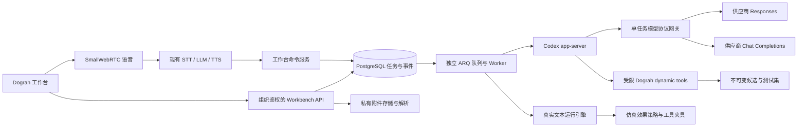

本文对应 `codex/agent-workbench-mvp` 分支。目标是让你的用户在一个工作台里完成 Agent 构建、文本仿真和调优，同时继续使用 Dograh 原有编辑、版本、电话和语音测试功能。实现使用真实 Codex app-server；离线原型仍在 `ui/public/prototypes/agent-workbench/`，不代表真实服务的执行结果。

2026-10-19 更新：已完成实时语音读取附件、构建、文本仿真和调优闭环，并在 API 8016 的独立环境关闭 MPS 验证。MPS 开关、初始化控制、模型依赖预检和仿真模型快照已落地；第 9 节保留解耦总方案，并在 9.7 节区分已实现与后续范围。API 8000 的原实例未变更，示例 Agent 只采用到草稿。

## 2026-10-23：有上下文的测试执行

仿真调用 `execute_text_chat_pending_turn`，使用固定定义和模型快照，与普通文本对话共用 Pipecat 执行引擎。测试运行标为 `purpose=evaluation`，对话、节点事件、用量和评审保存在工作台；普通运行列表与业务统计排除这些记录。文本仿真不验证语音链路，外部写入按显式测试夹具执行。独立测试 worker 在启动时加载组织的 Langfuse 配置并订阅跨进程配置同步；工作台展示实际运行编号及新运行的追踪链接。未上报的历史追踪不伪造补写。

历史客户发言不能脱离原坐席提问直接作为另一段完整对话的输入。测试方式与对话有效性现在独立于业务评审记录：

- `single_step` 保留所选客户句之前的原始双方对话，仅在真实文本引擎执行这一个客户句。后续参考答案不进入模型；起始节点依据前文定位并显示推断依据。不能唯一定位时保留为上下文不确定，不猜节点或伪造已执行。未指定轮次时逐个展开所有客户轮次，明确指定时保留来源轮次。
- `dynamic` 从资料冻结客户事实、诉求和单独标注的测试假设。后续观察有适用时机，不作为通话开始时已完成的状态。客户仅看到冻结场景和实际对话，不看到 Agent 提示、评审标准或未来参考坐席答案。每个拟回复经独立承接检查后才能发送，错误回复可修正一次，仍无法确认则停止并保留原因。
- `scripted` 保留固定输入的回归用途；有参考上下文时，发送前检查确认语、操作结果和引用值是否仍适用于实际对话。发生错位后停止继续灌入脚本。

场景准备、实际回复、独立检查、评审过程及结果逐轮持久化并在工作台显示。结果区区分已完成测试、有效/无效对话、未覆盖诉求和执行异常。无效案例不进入正常流程通过率，也不作为自动修改 Agent 的依据；独立观察到的回复与评审线索仍保留。模拟操作不等于真实后台操作，测试假设不写入长期记忆。

分析与独立评审继续使用工作台模型；客户生成可复用已配置的兼容运行模型，保持独立检查。每个结果记录客户模型、检查模型和场景指纹。任务固定候选、运行模型和原始来源，不修改 Agent。重新执行保存为新评测，原结果不覆盖；恢复完整用例时校验原用例与模型，未完成场景保留已冻结的假设。

批次仅用于保存测试集和结果，所有批次共用一个受控的用例并发队列；长对话不会让下一批整体等待。全量统计合并各批最新快照，重复回调不重复计数。结构化结果缺失可重新提交一次；连续无效结果停止纠错，模拟客户进入独立修正流程，执行异常与 Agent 业务结论分开保存。

## 2026-10-23：完整工作台的资料、需求与验证方案

你可以提供文字目标、零散说明、业务文档、SOP、知识资料、示例对话和测试表格。工作台负责理解资料用途、落实本次要求并提供可核对的执行结果。无需先把资料整理成完整 SOP。通用能力不得包含某个商家的费用、业务分支或话术规则。

| 能力 | 修改与保留的行为 | 完成证据 |
| --- | --- | --- |
| 资料与需求 | 按 Agent 追踪原始输入、附件、版本来源和已确认约束；历史来源检索与当前任务指令分离。文件格式不决定规则权威性，示例、问题和假设不能自动成为要求。原文保留来源、时间、哈希和分页读取。 | 任务依据卡及可读取的原文；缺少来源明确标记，不以生成配置补成事实。 |
| 当前任务与记忆 | 保留分析、构建、只测试和调优的执行边界。会话压缩管理工作上下文，长期约束仍由有来源的 Agent 记忆管理；原始资料保留，确认、替换和撤销保留版本。 | 只测试或只复核没有 Agent 修改；旧任务不会变成本次待办，模型推测没有记忆确认权限。 |
| 构建和覆盖 | 依照原始需求选择节点结构，保留未授权变更的事实、分支与确认步骤。局部修改复用候选；独立审查把每项要求映射到来源、适用范围、节点和测试。整体质量要求检查整个适用范围。 | 候选差异、来源引文、需求覆盖明细；保存候选不等于完成验收。 |
| 测试 | 冻结用例与模型快照，运行真实文本 runtime，保存实际对话、状态转换和运行编号。引用旧用例时采用本次任务说明，旧版本名称不影响新任务。 | 原始样本数量、实际执行/复用数量、运行异常和未覆盖项分别记录。 |
| 分层评审 | 原始业务资料确定业务要求；候选配置用于检查构建还原与执行一致性。分开业务违规、配置执行不一致、脚本错位、资料冲突、体验建议与证据不足。独立复核检查实际对话和逐字引文。 | 适用条件、影响程度、来源片段、实际回复、归因层级；无独立业务依据不能宣称业务通过。 |
| 修复与复核 | 可定位且有原始依据的 Agent 缺陷才进入自动修改；资料、脚本、评审或运行机制待查问题进入对应处理路径。已有真实对话可单独重新评审，原结果保留。 | 修复计划指向具体失败；冻结断言不被降级；复核保留运行编号与对话且不调用 runtime。 |
| 过程与可靠性 | 保留流式进度、分页聊天、候选预览、取消和持久记录。任务依据冻结后可恢复；相同模型配置的重复冻结幂等，变更配置仍拒绝。 | 工作台可展开任务依据、需求覆盖和评审证据；错误、无法判定与完成状态准确区分。 |

实施顺序：先独立原始依据与任务边界，再接通构建覆盖和分层评审，随后接入只复核与界面，最后做隔离测试和已有实际对话验收。现有的图结构保护、断言回归、模型配置隔离、流式通信和分页历史继续复用。

`_task_basis` 保存服务端不可变原文快照，列表响应只返回 `task_basis` 元数据；原文通过经过组织和会话鉴权的分页接口读取。每次评审记录依据指纹、候选指纹和模型。大资料逐页读取，不用固定最近若干条历史替代完整来源。检索到的历史人类原文仍需核对时间与适用性，不自动升级为已确认长期记忆。图片未完成核验时保留未判定提示。

自动修复与验收的边界：体验建议不能变成业务失败，脚本错位不能自动导致 Agent 修改，业务来源缺失不能通过猜测补齐。只有当前任务授权构建或调优时才创建修改候选；采用草稿与发布继续由现有明确操作触发。已通过的单条回放只证明已观察行为，不代表覆盖全部可能的业务分支。

验收必须覆盖：同一 Agent 跨会话恢复原始资料；不同组织/Agent 不串资料；只测试不修改；仅复核不重跑；模型建议不成为事实；原文引用不可伪造；大量资料尾部不被截断；来源冲突不被静默覆盖；整体要求有覆盖明细；旧用例说明不覆盖本次任务；冻结模型可幂等复用；历史结果保持不变。实际验收记录见 [验收记录](/architecture/agent-workbench-acceptance)。

## 1. 范围与关键决策

| 决策 | MVP 实现 |
| --- | --- |
| 界面 | 复用原工作流编辑器的画布、节点与连线；右侧工作台包含构建 / 文本仿真 / 调优，附件和语音输入跨页签保留；没有 Journey |
| 构建执行器 | 独立 ARQ Worker 启动开源 Codex app-server；每个组织内的 Agent 对应持久 Codex project，每个工作台会话恢复其原生 thread；内部修复与审查使用临时隔离线程 |
| 模型 | 复用当前组织的 Dograh Models / Provider Connections，包含 Qwen 等 OpenAI 兼容模型 |
| 构建协议 | 会话配置 `model_protocol=chat\|responses`；界面可选，运行中的任务禁止切换 |
| 工具接入 | Codex dynamic tools 直接调用 Dograh 服务；不经过 Dograh MCP 的 HTTP 认证和传输层 |
| 附件 | 私有对象存储、本地受限解析进程；支持上传、拖放、粘贴和已有附件复选 |
| 仿真 | 固定用户脚本 + 真实 Pipecat 文本引擎 + 确定性断言；外部业务效果使用显式夹具 |
| 调优 | 冻结候选基线和测试集，Codex 修改后重跑；只推荐有改善且无通过用例回退的结果 |
| 实时语音 | Dograh SmallWebRTC → 现有 STT → LLM → TTS；语音工具调用同一工作台命令服务 |
| 生效 | 不可变候选 → 用户应用到草稿 → 原编辑器审核与发布 |
| 回退 | 现有实现关闭工作台后保留原 MPS Builder；独立模式的回退改造见第 9 节，不能自动恢复 MPS 请求 |

已有实现替换了 Agent Builder 的生成路径，但 MPS 仍承担托管模型、知识库文件处理、录音转写、语音目录、配额和账单等职责。独立模式需要同时处理这些入口、默认初始化和运行时模型选择，才能形成可验证的无 MPS 构建与测试闭环。对外 Dograh MCP 的本地 API Key 认证继续保留；它不要求使用 MPS Service Key。

## 2. 架构与协议选择



### 2.1 Codex 与模型是两个配置层

Codex 是规划与工具执行器，Qwen 是它调用的模型。当前 Codex app-server 通过 Responses 协议访问一个只监听 `127.0.0.1` 的任务专属网关，网关根据会话配置选择上游协议：

- **responses**：访问已配置 `base_url + /responses`，保留函数调用与结果语义，限制为本任务工具白名单，关闭服务端存储。
- **chat**：将 Responses 消息转换成 Chat Completions，访问 `base_url + /chat/completions`，把 `tool_calls` / `tool_call_id` 转换回 Responses；`developer` 角色映射为 `system`。
- 两种模式都保持相同的配置模型、连接密钥和工具权限；不会因接口失败静默换协议或换模型。
- 当前提供的 `qwen3.6-27b` 已在 Chat 路径实测成功；其当前地址的 Responses 请求返回不支持该模型。Responses 路径已做契约测试，实际供应商联调需要选择支持 Responses 的模型。
- 上游使用 SSE 流式请求，实时转发文本和工具参数增量；界面展示等待、生成字符数、耗时和重试状态。
- 此配置只控制 **Codex 构建和调优** 的模型接口。仿真和实时语音仍走 Dograh 服务工厂及相应模型连接。

API 请求示例：

```json
{"name":"预约助手","model_protocol":"chat"}
```

切换已有会话使用 PATCH `/api/v1/agent-workbench/sessions/{session_id}`：

```json
{"model_protocol":"responses"}
```

当前实现要求构建 LLM 是 OpenAI 兼容连接。不要把个人 Codex 登录目录挂载给用户任务。供应商 API 密钥只在网关进程内存里使用；Codex 子进程只收到临时的本地网关令牌。

### 2.2 为什么先不经过 MCP

工作台、Worker 和 Dograh 后端属于同一应用，直接调用领域服务可以共享组织身份、取消租约、校验器和数据库事务，减少 MCP API 凭证与网络连接管理。复用 `api/mcp_server/ts_bridge.py` 的 SDK/AST 解析器并不意味着通过 MCP 传输。

对外 Dograh MCP 保留。以后需要外部 Codex 客户端操作工作台时，可以给同一服务加 MCP 适配层，暴露 `create_session`、`submit_instruction`、`get_status`、`run_evaluation`、`tune`、`cancel` 等能力。MVP 没有新增对外 MCP 工具；不能把“协议设计”当作已上线接口。

## 3. 用户界面与完整流程

### 3.1 构建

1. 新建 Agent 创建会话后进入原编辑器的右侧工作台；已有 Agent 从列表或原编辑器顶部「工作台」打开。
2. 后端创建组织归属的会话。新 Agent 只有空草稿，不自动生成已发布版本。
3. 用户选择当前草稿或已有候选作为修改起点，再输入目标，可选最多 5 个已经解析完成的附件，也可以使用实时语音描述目标。
4. API 校验组织、附件状态、请求幂等键和会话并发状态，写入任务及 `task.queued` 事件。
5. Worker 获取 60 秒租约，每 10 秒续租。读取当前草稿完整指纹、组织模型配置与附件清单。
6. Codex 读取上下文和节点规格，通过 `@dograh/sdk` 生成 TypeScript。
7. AST 解析器只接受声明式 SDK 子集；不执行模型生成的 JavaScript。校验真实图结构、触发路径、工具名称冲突及引用资源的组织归属。
8. 保存不可变候选和测试集。任务成功必须有真实保存结果，不以模型声称完成为依据。
9. 页面通过事件游标和状态轮询恢复进度，显示流程、代码、摘要和可执行测试集。

### 3.1.1 原编辑器中的右侧工作台（2026-10-20）

统一入口为 `/workflow/{id}?workbench=1&session={session_id}`。未指定会话时，服务端恢复该用户、组织与 Agent 的最近会话。旧 `/workflow/workbench?session=...` 和 `?workflowId=...` 链接仍可访问，解析会话后跳转到原编辑器。

`RenderWorkflow` 保留唯一的 React Flow 实例，候选预览也使用 `GenericNode`、`CustomEdge` 和现有节点规格。候选节点与连线存放在独立的本地状态，预览期间禁止编辑、删除、连线、保存和撤销草稿；缩放、查看详情与本地整理布局可用。选择「当前草稿」或关闭工作台恢复原草稿，原 Model / Variables / Settings 的未保存状态不会因预览而销毁。

右侧工作台与原 Test Agent 面板互相切换。应用候选必须点击「应用到草稿」，存在未保存修改或正在保存的设置时暂不可应用。应用成功后重新读取完整的草稿图、配置、变量和名称，重新初始化编辑器，避免旧前端状态覆盖新草稿。预览与应用都不会自动发布。

面板默认宽度上限为 520px，顶部「展开工作台」可扩展到 780px（同时受视口及编辑器可用宽度限制），原画布仍在左侧。展开只改变容器宽度，不重新创建会话或断开语音。构建对话占据剩余高度，独立滚动；阅读历史时不自动跳回底部，可点击「回到最新消息」继续跟随。

删除占据整行的后台任务说明，保留各页签都可见的单行进度与取消操作。模型协议及连接检查放在顶部「工作台设置」中；候选摘要、Variables 和代码通过版本旁的信息按钮打开。附件只占一行，点击附件数量打开完整列表、选择引用或上传文件，弹层不会挤压对话区。文字和语音共享会话资料库；勾选只标记本次重点，内容按需读取。

文本仿真与调优页默认收起空的文字输入框，为结果保留阅读空间；有未发送文字或语音连接时保持展开。测试场景使用下拉选择，完整对话和断言纵向阅读。调优页也显示当前测试集，测试集选项带序号以区分同名历史版本；点击「查看推荐版本」同时选择该任务对应的候选及测试集，避免显示另一测试集的空结果。

关闭面板会清理浏览器侧语音连接与轮询，已提交的任务继续由后台 Worker 执行。重新打开恢复同一会话中的任务、候选、测试结果和资料库，不再重复勾选上次指令的附件。候选已经应用时，重放历史完成事件不会再次切回旧候选预览。

工作台刷新得到的已保存目标快照与编辑器初始快照不一致时，重新读取草稿，解决其他标签页应用后原画布仍显示旧节点的问题。比较包含名称、图、配置和变量，忽略 JSON 键顺序。存在未保存编辑、未发送文字、保存请求或语音会话时保留现场并提示同步，不自动重载。

### 3.1.2 候选变量

`save_candidate` 接受可选的 `template_context_variables` 对象，供 Codex 写入有用户请求或附件依据的字符串默认值。SDK TypeScript 负责图，变量通过该参数写入候选快照及原有 `WorkflowDefinition.template_context_variables`；不增加数据库表或迁移，也不改变对外 MCP。

未传入的原有变量保留。保存时扫描节点和连线的文本，按真实模板渲染器规则识别引用，缺少值的业务变量自动注册为空字符串；不生成随机姓名、地址或测试值作为默认值。过滤带 fallback 的变量、嵌套运行时路径、系统变量和内置 `current_time` / `current_weekday`（含时区后缀）。`current_date` 不是内置变量，需要改用内置时间或由调用方传入。

上下文、校验和保存结果均返回默认值、引用名和缺值列表。候选说明展示变量，点击应用后与图一起原子写入草稿。旧 Agent 的 Variables 页面也展示尚未注册的引用供用户填写、保存；仅打开页面不会修改数据库。构建与调优使用相同工具及变量合并规则，语音指令走相同的后台构建链路。

文本仿真以候选默认值作为初始上下文，再由每条用例的 `initial_context` 覆盖。测试专用姓名等只放在用例上下文，不回写候选。普通通话沿用原有变量传入策略。

### 3.1.4 运行分析与连续对话（2026-10-20）

输入区新增 Agent Runs 列表，可选择某次运行或分析最新运行，也可直接追问“刚才为什么这样回复”。这里的运行记录来自 `workflow_runs.purpose=normal`，与文本仿真评测分开。服务端同时校验组织、工作台会话和 workflow_id，不能通过输入其他 Agent 的运行编号越权。

`read_agent_run` 返回运行编号、时间、definition_id、分段证据和分页游标。对话从该运行记录对应的存储后端下载；变量包含 initial_context 与 gathered_context；日志按相同事件正文归组，保留次数、首末时间及原始索引，`logs_raw` 可查看完整顺序。缺少转写、下载失败、版本缺失都显式报告，不用当前草稿替代；运行引用可变 draft 时提示内容可能已经改变。敏感配置字段在送入模型前脱敏。单段最多 24,000 字符，转写读取上限 2,000,000 字符并标记截断。

每条任务在现有 `WorkbenchJob.output.history_before` 保存入队时事件边界。2026-10-22 起，文字构建/分析任务使用持久 Codex project/thread：组织与 Agent 隔离 `CODEX_HOME`，同 Agent 的会话各自绑定原生 thread，后续通过 `thread/resume` 继续，取消固定截取最新 12 条事件。首次迁移将边界以前的原始用户请求、助手回复和精简结果凭据按顺序通过 `thread/inject_items` 导入；导入全部成功后才保存绑定。恢复失败明确报错，不创建空白线程掩盖历史丢失。工作台事件原文继续保留，`read_conversation` 支持查原文。

任务内的历史与摘要由原生 Codex 管理。`WORKBENCH_MODEL_CONTEXT_WINDOW` 配置实际供应商的上下文容量，压缩阈值预留输出空间；这是单次上下文容量，不是累计任务预算。默认 131072，需要部署者按实际模型调整。压缩事件显示在工作台；摘要不替代原始记录。不同会话共用当前 Agent 草稿，附件仍按会话隔离；不把另一会话的助手推测自动提升为 Agent 全局事实。实时语音助手保留自己的短期语音上下文，委派的构建/分析进入对应 Codex thread。

原生 Codex 管理会话持久化与自动压缩；跨会话长期记忆由 Dograh 的来源记录和人工确认账本提供，未启用模型可自行写入的跨线程 MemoryTool。每轮另给当前草稿指纹、匹配候选和最近任务结果，避免将历史助手所说的“通过”误当成已经采纳或发布。旧运行证据仅提供可用索引，相关时才复用内容。原文回溯按批分页；`limit=1` 仅用于展开本轮已经标记截断的具体消息，顺序扫描会自动扩大为一页，避免逐条回读产生大量模型请求。

Agent 长期记忆按组织和 workflow_id 隔离：已提交的用户请求和已解析附件文本自动成为可分页、可搜索的跨会话来源，不把问题、假设或助手回复自动确认为事实。来源原文仍存于原始任务/附件记录，模型仅取得索引并按需读取；图像不通过文本记忆冒充已解析内容。

用户在“Agent 长期记忆”面板直接填写，或从历史原文选取并确认长期需求、约束、SOP。确认操作记录用户、来源引用、内容哈希、时间；只有经过认证的用户接口可写，模型工具没有确认或覆盖记忆的能力。修改创建新记录并标记 replaces_id，撤销和被替换记录保留用于追溯。界面和数据库均使用记忆 revision 防止另一会话的修改被覆盖。旧聊天不会未经确认整体转换成事实清单。

每轮给 Codex 当前有效记忆及来源索引，覆盖旧线程摘要。短条目在字符窗口内直接提供；长条目以 ID 和哈希引用，通过现有 read_conversation 的 agent_memory 范围逐页读全文（兼容已绑定的原生线程）。遗漏的读取页不能通过“已读”检查。所有有效确认项都必须进入独立需求覆盖审查，不能只处理本轮重复提到的条目。确认的 SOP 以原文绑定到节点，服务端拒绝遗漏分段；同名标题不能覆盖其他 SOP 文档，替换/撤销时退出旧文档的约束。原文档始终保留，不用摘要替代。语义遵循仍需仿真和观察证据，不能把保存记忆视为运行质量已经通过。

任务入队冻结有效记忆 revision，保存候选和应用到草稿时再次核验。另一个会话修改了长期要求时，旧候选必须重新构建。长期记忆的修改本身不会修改草稿或通话模型。实时语音的短期上下文保持独立，委派给工作台的构建任务使用上述长期记忆。

持久目录由 `WORKBENCH_DATA_DIR` 指定，默认 `~/.local/share/dograh/workbench`；必须与数据库一同备份。Docker 挂载持久卷，Helm 工作台 Worker 使用单副本与持久 PVC，滚动更新改为重建以避免卷冲突；队列任务仍保存在数据库。恢复备份时须同时恢复 thread 存储和数据库绑定。

页面历史与模型上下文独立：打开会话只取最新 60 个事件，上翻以 `before` 游标补载并保持当前消息位置，新事件用 `after` 增量同步并去重。模型输出进度不会每两秒拉取整份候选、图和评测档案；资源改变、用户操作或定期校验才更新状态，未变化的 revision 仅返回轻量确认。会话菜单支持新建和切换，同一 Agent 的草稿保持共享。

构建增加独立的需求覆盖审查：检查原请求范围、实际候选和测试设计；设计通过后运行真实 runtime 仿真，再审查逐轮回复是否提供了足够证据。发现覆盖缺口时继续局部修订；缺失业务信息或连续两次没有减少缺口时保留候选并标记未完成。审查记录必须引用真实用户原话、存在的节点与用例。它属于模型辅助审查，仍可能漏判，不能替代实际测试或宣称任意业务质量已得到证明。

后续审查必须保留已经识别的需求及其原始范围；设计修订可以新增场景和断言，但不能改变既有场景的输入条件或删除断言。测试与原始资料有冲突时明确报告，不能通过降低验收标准来宣称修复成功。独立审查适用于通用需求，不包含客户名称、业务数值或指定分支规则。

指令支持 `mode=auto|analyze|build`。自动模式按当前意图选择；仅分析模式不暴露保存候选、保存测试集等修改工具。分析必须通过 `finish_analysis` 提交最终回答，只有进度说明不算成功；必要时在同一 Codex 线程续问一次，网关仅对这一次请求指定完成工具，仍无结论则失败。Chat 适配层区分带工具调用的 commentary 与最终回答。构建模式保留候选和测试集的保存要求；若缺少结果，在同一线程最多续问两次，用一次性工具选择逐项补齐，且共享原任务预算。调优保留冻结测试集和回归检查。运行诊断发现基础设施故障时应先指出故障，不能虚构为话术缺陷。

已实际读取的运行和附件通过 `evidence.read` 显示在聊天中，连续读取默认折叠成一行，展开可跳转运行详情；复用已有证据单独标注。附件可用不等于本次已读；分析不修改草稿，候选仍需用户应用后才进入草稿。

运行证据按当前问题读取，不再强制每轮遍历概览、对话、变量及两种日志。已脱敏的证据页保存在任务输出的内部 `_run_evidence` 字段，不随公开任务详情或事件返回。后续任务只恢复同一组织、同一会话、入队边界之前的证据；复用前核验运行数据和历史定义指纹，未结束的运行或已变化的数据不能复用。恢复窗口为最近 20 个任务、最多 48,000 字符，未恢复的页仍可按需读取。历史定义可能指向可变草稿，相关警告随证据保留。

流式响应在所有工具参数通过 JSON 对象校验前不发出工具完成事件。模型生成非法工具参数时，报告工具名及 JSON 错误位置（不回显参数内容），在原 Codex 线程内最多发起两次格式纠正；原响应的工具不执行，已有成功保存不会被重放。网络中断仍遵循流式重试规则，不能把已开始输出的响应当成未发送请求重试。

#### 通用构建与自动验证

构建逻辑不包含客户名称、收费规则、设备分支或其他业务专用判断。节点数不作为优化目标或验收指标。模型根据资料中的步骤、进入/退出条件、等待确认、分支、重试和不同结束方式组织工作流，并保留现有有效结构。原文标题不必机械对应节点，但连续步骤也不能仅为减少节点而合并；合并需要保持状态边界与行为，并通过同一套需求测试。原文有冲突或缺少事实时不能自行编造结论，未知变量保留为空。

已移除将纯对话 SOP 自动压成“对话 + 结束”两个节点的 `save_prompt_agent` 路径。所有候选使用相同的 SDK 保存与校验机制，节点数量由需求决定。提速依靠上下文复用、减少重复调用和局部修改。修复已有 SDK 可提交唯一匹配的局部替换，避免每轮重新输出整张图；保存结果返回实际节点 ID 和名称供测试引用。

跳转条件必须区分当前步骤的确认与整个任务的完成。结构化资料可使用 `save_scenarios` 将每句用户输入与对应回复的短语检查放在同一条记录中，由服务端编译成固定轮次断言；需要上下文、工具或节点顺序断言时使用 `save_suite`。两种测试形式均适用于多节点图。没有实质改变执行内容的调优保存会被拒绝，防止原样重存被视为修复。

固定测试的预期与原文冲突或缺少必要证据时，修复模型可调用 `report_verification_issue`，保留候选并报告待处理原因；不允许为了通过测试修改业务要求。连续两次提交执行内容不变的修复也进入待处理状态，避免空转。该出口不能代替完整的测试预期审查，模型生成的测试仍可能存在语义错误。

当前指令有多个“节点”标题或 Markdown 标题时，服务端为每段原文生成内容指纹。模型使用现有 SDK 生成阶段编排和分段映射，服务端原样插入各阶段原文。遗漏、同一阶段重复分配或映射到不存在的阶段会阻止保存；共同规则可引用到多个阶段。映射校验失败后可以只重发映射，复用同次任务上一次未保存的代码和变量。修改已有候选时恢复其原文分段，局部结构化更新按相同标题替换并保留其他段落。此完整性报告证明结构化原文得到保留，不证明所有业务规则执行正确；未识别为结构化资料的普通说明与附件仍通过模型阅读，不能宣称同等逐字保留保障。

构建上下文和核心节点规格预载一次，已提供上下文时不再暴露重复读取工具；显式构建任务只提供带校验的保存操作，避免先校验再保存整份相同内容。生成候选和测试集后，后台立即使用候选的实际通话模型跑文本仿真；构建模型与评测模型分别冻结快照。失败时使用逐轮节点、回复和源资料定位问题，再对同一个不可变测试集复测。断言改善且没有原通过项倒退时才能替换最佳候选；新出现的回归也会保留给下一轮。默认不按轮数截断，有进展或新失败证据便继续，连续两轮既无改善也无新证据时停止。`WORKBENCH_BUILD_REPAIR_ROUNDS` 留空采用此规则，正数为部署方显式上限，0 禁用自动修复。服务错误或无法判定会明确保留为待处理状态；只有同一候选连续两次完整通过才标记确认通过。候选仍需应用到草稿，不自动发布。

界面区分生成、自动测试、修复和仍有未通过项；任务输出分别记录 `generation_seconds` 与 `total_seconds`，不把保存测试集当作测试已通过。各用例保持独立运行和上下文，以 `WORKBENCH_EVALUATION_CONCURRENCY` 控制并发（默认 3，范围 1–8），结果按原测试集顺序保存。

测试只提交用户话语，助手回复由真实运行时生成。保存前校验断言轮次以及候选节点的真实 ID / 唯一名称；不能把节点类型误当作节点 ID。结构化 SOP 的每条用例还必须包含从原文导出的内容、上下文或工具断言，只有访问节点和完成标记不能证明执行效果。测试输入中的业务事实属于用例数据，不成为构建器中的业务规则；这些静态校验也不能替代测试预期本身的人工审查。

评测还检查固定脚本是否全部执行：若 Agent 提前结束，导致剩余用户轮次未执行，即使关键词或结束断言满足也判失败。界面展示实际执行轮次数与逐轮断言的位置；自动修复接收同样的失败证据。

### 3.2 附件

允许 TXT、MD、CSV、JSON、PDF、DOCX、XLSX、PNG、JPEG、WebP。单文件最大 20 MiB，每条指令最多标记 5 份重点附件。附件绑定组织和会话；已解析资料在本会话内可按需读取，不再要求每轮重复勾选。发送成功后清除本次重点，保留资料库。默认只给模型文件索引；文本通过读取工具分页返回，图片只在调用读取工具后作为图片结果返回，不再每轮自动附上像素。

| 格式 | 解析与限制 |
| --- | --- |
| TXT / MD / JSON | UTF-8；JSON 结构化格式化；最多保留 200,000 个文本字符并标记截断 |
| CSV | 最多 5,000 行；超过限制报错 |
| PDF | 不加密、最多 200 页，按页提取；扫描件无文本时报错，不虚构 OCR 内容 |
| DOCX | 段落和表格；不执行宏 |
| XLSX | 只读、缓存值、不读取外部链接，最多 50,000 单元格；不计算公式 |
| 图片 | 验证格式和像素，最多 2,000 万像素；清除元数据并生成最多 768px 的模型输入，需视觉模型 |

Office ZIP 最多 5,000 个成员、解压大小 80 MiB，拒绝宏及加密文件。解析子进程使用最小环境，30 秒超时、20 秒 CPU 限制；Linux 额外设置 768 MiB 地址空间上限。图片解析不等于当前 Qwen 文本模型具备视觉能力；不支持图片的模型应返回明确失败，用户可改用视觉模型或文本说明。

附件用独立私有 bucket，不复用本地普通录音 bucket 的公开策略。对象键包含组织和会话；接口不返回公开 URL 或存储密钥。模型读取到的文档内容被视为业务数据，不能改变工具权限。MVP 解析在上传请求内完成，尚未实现独立解析队列、OCR、复杂版式还原和自动清理策略。

### 3.3 文本仿真

用户可以选择候选、编辑测试集并运行。每次编辑保存一个新的不可变测试集；已提交任务固定引用原测试集 ID。

每条用例包含：名称、固定用户消息、初始上下文、业务工具夹具、可选预取上下文与知识库结果、断言。支持：

- `contains` / `contains_any` / `not_contains`：只检查 Agent 文本，不把用户话语作为命中。可指定 `turn` 检查某轮回复：0 为开场、1 为第一条用户消息后的回复。指定轮次不存在时失败；`contains_any` 接受一组可替代的字面表达。
- `node_visited` / `node_not_visited` / `node_sequence`：检查真实运行引擎的节点迁移事件，分别表示访问、未访问和按顺序访问（允许中间有其他节点）。引用可为节点 ID 或精确且唯一的节点名称；评测前根据候选解析为 ID，不存在或重名时报错，不将错误视为通过。
- `tool_called`：检查实际发生的夹具工具调用。
- `context_equals`：检查最终收集上下文。
- `completed`：检查对话是否完成。

仿真调用 `execute_text_chat_pending_turn`，每个用例持有独立运行记录、固定候选 definition 和逐轮 checkpoint。每套最多 20 条用例，每条最多 40 条用户消息，每轮 75 秒超时。保存逐轮文本、节点事件、工具调用、断言结果与模型用量。

**效果隔离发生在实际运行引擎内部**：打开 MCP 会话之前直接返回；HTTP/MCP 工具使用夹具；预通话 HTTP 预取改用 `pre_call_context`；知识库查询改用 `knowledge_result`；录音节点不支持时拒绝；不触发普通通话完成集成、账单或电话动作。缺少夹具、服务错误、超时都不能算通过。

MVP 的夹具 schema 由测试作者显式提供，不能证明线上工具 schema 或业务服务可用。结果分为 `passed`、`failed`、`error`、`inconclusive`。字面断言不是语义评分，更不是生产环境业务验收。

### 3.4 调优

1. 固定候选 ID、测试集 ID、当前任务解析出的模型配置。
2. 先运行基线，获得真实失败对话。
3. 将用户调优目标、冻结测试集和失败证据交给 Codex。调优工具集不提供 `save_suite`。
4. Codex 保存新候选，按相同测试集和同一任务模型配置重跑。
5. 接受条件：用例数相同、没有错误或无法判定、所有原先通过的用例仍通过、通过数严格增加。
6. 最多 3 轮；没有改善时保留原推荐候选。全部通过时停止，不进行无依据修改。
7. 候选仍需用户采纳到草稿；不会自动发布。

冻结的是测试集和本任务持有的模型配置对象；尚未实现供应商随机种子控制、跨任务完整配置重放或统计显著性分析。

### 3.5 实时语音交互

语音是工作台的输入与答复通道，用户可以说“根据这份附件构建”“运行测试”“根据失败结果调优”“取消任务”。

- 使用已有登录鉴权、组织模型连接、STT/TTS 服务工厂、SmallWebRTC 和 ICE/TURN 配置。
- 浏览器发送麦克风轨道；服务端 STT 形成完整话语，LLM 调用工作台工具，TTS 播报结果。
- 语音与文字共享会话、附件、当前候选/测试集选择及任务状态。
- 语音工具：`submit_instruction`、`get_status`、`read_attachment`、`list_agent_runs`、`read_agent_run`、`read_conversation`、`run_tests`、`tune_agent`、`cancel_task`。
- 上传完成并勾选的附件随 `context` 消息同步；服务端校验组织、会话、解析状态以及候选/测试集归属，原子替换上下文后返回 `context.applied`。界面确认收到相同选择后显示已同步。无效选择返回 `context.error` 并暂停工具执行，直到收到有效选择，避免继续使用旧附件。
- `read_attachment` 按需读取会话资料库的文本，每页最多 8,000 字符；未解析或其他会话的文件不可读。图片只返回元数据，语音助手不能声称已经读懂图像；构建任务仍按现有视觉模型能力处理图片。
- 文字提交后清除本次附件重点，语音可继续按需读取会话资料；刷新或重连会恢复持久对话历史，文件无需重新上传。
- 语音命令携带当前候选、测试集和附件；没有显式候选时使用最近成功任务推荐的候选，不选用被调优回归拒绝的版本。任务提交只回传任务编号、类型与状态，结果通过 `get_status` 查询，避免把整份内部任务记录交给语音模型。
- 可恢复的供应商错误显示提示并允许底层重试；致命错误才断开。语音转写原样保留，包括识别错误，实际执行以工具参数和持久任务结果为准。
- 关闭语音或打断播报不取消后台任务；只有明确取消命令才取消任务。
- 每组织最多 2 路工作台语音，每路最多 10 分钟。连接断开释放轨道、连接及 Redis 配额。
- 工作台语音与原有“Test Agent / Test Audio”不同：前者控制构建过程，后者测试目标 Agent 的实际对话。两者保留。

## 4. 数据结构

新增 7 张表，复用 `workflow_definitions` 保存候选图：

| 表 / 字段 | 作用与约束 |
| --- | --- |
| `workbench_sessions` | UUID 主键；organization_id、user_id、workflow_id；model_protocol；event_sequence；创建时间 |
| `workbench_events` | `(session_id, sequence)` 联合主键；事件类型、JSON payload、创建时间；支持断线续读 |
| `workbench_jobs` | 会话、kind、status、input/output JSON、error、lease_token、lease_until；`(session_id, idempotency_key)` 唯一 |
| `workbench_assets` | 会话、文件名、MIME、大小、SHA-256、私有对象键、解析状态/结果/错误 |
| `workbench_candidates` | 会话、任务、definition_id、SDK code、name、summary、fingerprint、base_fingerprint；创建后不修改 |
| `workbench_suites` | 会话、payload、fingerprint；每次编辑创建新行 |
| `workbench_evaluations` | 会话、任务、候选、测试集、状态、results JSON、summary JSON；用例结果嵌入 JSON |
| `workflow_definitions.status=candidate` | 候选不进入普通发布历史、发布指针与普通运行选择 |
| `workflow_runs.purpose` | 新增默认 `normal`，仿真用 `evaluation`；普通列表、报表和完成任务排除仿真 |

迁移：`d17b90c4e201_agent_workbench.py`、`e18c90d4e202_workbench_model_protocol.py`。回滚会删除工作台数据，操作前需备份；功能回退优先关闭开关。

### 4.1 租户、并发与采用

所有接口从登录用户获取组织，所有子资源先验证组织所属会话。模型不接收可自行选择的 organization_id。每会话同时最多一个构建/评测/调优任务，每组织最多两个运行任务，Worker 总并发 4。

数据库充当持久任务队列入口，Redis/ARQ 负责调度；每 15 秒扫描未入队任务。租约失效后标记失败，用户可重新提交，不自动重复外部调用。取消立即改变数据库状态；所有后续候选、事件和评测写入必须通过租约令牌校验。Worker 最迟下一次续租发现取消并停止子任务。

采用候选在事务内锁定组织模型目录和目标 workflow，并对**名称、图、模型配置、模板变量**计算完整指纹。当前草稿与生成时基线不一致返回 409，不能覆盖用户并发编辑。从已有候选继续构建或调优时也检查基线；若草稿已另行修改，需选择“当前草稿”重新构建。采用只更新草稿和原有工作流兼容字段，不更新 `released_definition_id`。

## 5. HTTP、事件与内部工具接口

所有 HTTP 路径前缀为 `/api/v1/agent-workbench`，使用现有 Bearer 登录身份。

| 方法与路径 | 作用 |
| --- | --- |
| GET `/capabilities` | 功能开关、Codex 安装检测、附件限制 |
| GET `/sessions/{id}/dependencies` | 当前草稿或候选的模型来源、角色、提供商、模型、端点主机及配置问题；支持 build/evaluate/tune/voice |
| POST `/sessions` | 新建或打开 Agent 的工作台 |
| GET `/sessions/{id}` | 当前草稿、候选、附件、任务、测试集、评测 |
| PATCH `/sessions/{id}` | 配置构建协议 |
| GET `/sessions/{id}/events?after=N` | 每次最多 200 条持久事件，序号递增 |
| POST `/sessions/{id}/instructions` | 提交指令、mode（auto / analyze / build）、重点附件 ID 和幂等键 |
| GET `/sessions/{id}/agent-runs` | 当前 Agent 最近 20 次正常运行，排除工作台仿真 |
| POST `/sessions/{id}/assets` | multipart 上传并解析 |
| POST `/sessions/{id}/assets/{asset}/retry` | 重试解析 |
| GET `/sessions/{id}/candidates/{candidate}` | 查看候选快照与代码 |
| POST `/sessions/{id}/suites` | 保存新的不可变测试集 |
| POST `/sessions/{id}/evaluations` | 提交仿真任务 |
| POST `/sessions/{id}/tune` | 提交固定测试集的调优任务 |
| POST `/sessions/{id}/jobs/{job}/cancel` | 幂等取消 |
| POST `/sessions/{id}/candidates/{candidate}/adopt` | 采用到草稿，检查冲突 |
| POST `/sessions/{id}/voice-tool` | 语音命令的同构 HTTP 入口 |
| WS `/sessions/{id}/voice` | 语音信令、上下文选择、转写、工具结果 |

事件包括 `task.queued/started/completed/failed/cancelled`、`codex.started`、`tool.started/failed`、`assistant.message`、`asset.uploaded/ready/failed`、`candidate.created/adopted`、`suite.created`、`evaluation.started/updated`、`voice.transcript`、`evidence.read`。界面每 2 秒同步状态；尚未实现服务端事件推送。

Codex 内部工具：

| 工具 | 输入和边界 |
| --- | --- |
| `get_context` | 初始上下文：脱敏 SDK、组织目录和会话索引；`section=editing`：当前编辑源码、版本、节点/分支名称和解析错误，含尚未通过校验的保留稿，支持分页 |
| `list_node_types` / `get_node_type` | 真实节点规格、字段和范例 |
| `list_attachments` / `read_attachment` | 会话资料索引；按 ID、offset、limit 读取文本与来源位置，图片返回独立像素项 |
| `list_agent_runs` / `read_agent_run` | 当前 Agent 的实际运行；读取概览、对话、变量、合并日志、原始日志或运行版本，分页并注明运行编号 |
| `read_conversation` | 历史用户消息、助手回答、语音转写和任务结果，按 before 序号向前分页 |
| `set_task_intent` / `finish_analysis` | 自动模式判定分析或构建；提交分析结论，分析不要求候选和测试集 |
| `read_node` | 按名称读取当前节点字段和分支；不传名称时读取当前 SDK、版本和解析错误，在预加载上下文的任务中也可恢复编辑 |
| `save_candidate` | 新建空白 Agent 可提交 SDK code；已有 Agent 使用 node_updates / edge_updates 修改指定字段，结构调整可使用局部 edits。一次完成 AST、图校验与不可变候选保存 |
| `save_suite` | 声明式 SimulationSuite；调优阶段不可用 |

模型网关剔除 shell、文件系统、网页搜索和未授权函数。工具白名单双向校验；任务默认不设总时长、累计 token、模型请求次数或工具调用次数上限，用户仍可主动取消。`WORKBENCH_MAX_MODEL_REQUESTS`、`WORKBENCH_MAX_MODEL_TOKENS` 默认均为 `0`（不限）；只有部署方显式设置正数才启用对应累计上限。累计 token 包括每次请求重复发送的上下文，持续记录为用量，不等于供应商账户余额或单次上下文窗口大小。单次输出仍受 `WORKBENCH_MAX_OUTPUT_TOKENS` 和供应商模型能力约束；连接中断、空闲超时及不完整工具参数不会当作成功结果执行。每次 Codex 运行结束或失败都尽力持久化 `model.usage` 事件；模型错误只返回有限诊断，不透传供应商敏感响应。

组织可在 `agent_workbench_build_llm` 配置项保存构建专用的 `ServiceSelection`（`provider_connection_uuid` 和 `settings`，不保存凭据）。仅普通构建/分析任务读取此项，并通过组织范围的模型目录解析；缺省继续使用工作流模型。通话、仿真和调优仍使用工作流模型，不会因构建模型选择改变。该管理配置目前由服务端设置，删除此项即可恢复继承。PA 的模型专用基址应使用 `https://pa.zkj.com/models/hhdccs/hwhhdc/maip/qwen3-235b-a22b-instruct`；生成路径由网关追加 `/chat/completions`。专用基址可能没有 `/models`，可在通过带鉴权的真实生成/工具调用检查后，使用模型目录 DB client 注册连接。

模型请求使用真正的上游 SSE：Chat Completions 的文本和工具参数增量转为 Responses 事件；原生 Responses 增量也实时转发。工具完成事件延迟到整轮成功后发出，截断、断流或未授权工具不会执行部分参数。默认单次输出上限 32,768 token，可用 `WORKBENCH_MAX_OUTPUT_TOKENS` 调整；`WORKBENCH_MODEL_IDLE_TIMEOUT=90` 是连续无数据的超时，不是整段生成时长，`WORKBENCH_MODEL_REQUEST_TIMEOUT=0` 默认不限制单请求总时长；设置正数可显式启用截止时间（含重试）。网关默认只在尚未转发模型输出时重试两次（`WORKBENCH_MODEL_MAX_RETRIES`），Codex 的 HTTP/采样重试关闭，避免重试相乘。工作台通过带 job_id 的 `model.progress` 展示等待、已接收字符数、耗时、重试次数和失败原因，每五秒更新；不再把最后一次工具名当作持续执行中的步骤。Worker 和 Codex 等待层也不再设置总时长限制；ARQ 的运行锁由心跳续租，用户取消或数据库租约失效仍会停止模型请求。

调优输入保留固定测试集、逐轮对话、断言结果和节点路径，移除重复的语音事件文本与计费明细。过长对话按用例和轮次分配字符预算并标记截断；完整原始证据仍保存在评测记录。工具列表不再暴露单独的 `validate_candidate`。已有 Agent 的修改以服务端保留的 SDK 为基础，优先使用 `save_candidate.node_updates` / `edge_updates` 修改指定节点或分支字段，提示词支持原文替换及追加，避免模型处理整份 SDK 的字符串转义。`read_node` 提供当前原文；结构调整使用 `save_candidate.edits` 精确替换局部片段。字段更新和成功保存会重新序列化 SDK，旧格式和变量名不可继续作为编辑依据；先通过不传名称的 `read_node()` 读取当前源码（也可用 `get_context(section="editing")`），分页按 `next_offset` 拼接，并携带 `expected_revision` 防止使用过期源码。语法或图校验失败保留提交；片段匹配或字段更新失败整批不生效；行为修复审核拒绝则丢弃该次修复。恢复入口在 SDK 无法解析时仍返回原始源码和解析错误，解析成功时还返回当前节点与分支名称。图错误附带节点名称、分支和原有入口信息。遗漏原节点或分支会被拒绝；需求明确要求删除、重命名或改道时，须用 `removals` 逐项说明移除的节点和原分支。成功保存后保留已经通过校验的删除声明，后续修改仍严格核对与原图的差异；新增删除必须继续声明。恢复信息中的 `removals_required_for_current_graph` 给出相对受保护原图的完整差异，用于检查声明是否遗漏或多报，绝不自动接受删除。合并或改道时还要核对受影响的开场、共享规则和结束编排，修正旧节点边界与工具作用域假设，保留原业务要求与已知事实。重复读取默认 `get_context` 只返回恢复入口提示，`section=editing` 可重复读取且不重载组织目录。构建结果记录局部修改次数和替换字符量。

新建 Agent 或用户要求重构时，工作台默认优先采用四个物理节点：开始、承载完整业务对话的 Agent、结束和全局规则。SOP 的业务阶段组织为主 Agent 的内部阶段；不同终止条件可通过不同标签的边汇入同一个结束节点。用户指定的节点数量、独立节点、结构和特殊能力优先；必要工具、副作用、错误分支、业务核对及需独立执行的集成不能为凑四节点而省略。四节点是构建偏好，不是保存校验或验收门槛。既有 Agent 的局部修改和自动失败修复保留原拓扑；未修改节点中已有的 SOP 注入提示也原样保留。

通用编排按实际对话接收同一句中多个已完成步骤，只追问缺失的前置事实；插问后回到实际未完成步骤，状态变化后接续最新事实。普通提问与拒绝按用户含义区分；重试或挽回次数按原 SOP 的单位、范围、上限和重置条件核对完整历史，插问或分支切换本身不重置。成功结束须满足适用前置条件、必要工具结果和原 SOP 要求的最终核对。内部阶段用逐轮内容、上下文及工具结果验证，不能仅凭节点访问或通话结束判定业务已完成。这些提示不改变 workflow 执行语义，也不提供硬性状态机保证；文本仿真通过不能替代真实语音链路回归。

追问须同时具有来源依据与信息缺口：SOP 或实际工具约束要求该事实，且完整对话（包括触发节点切换的客户回复）尚未提供足够信息，或存在影响该要求的冲突。缺一项只补该项；字符串字段本身不隐含精确日期、时间范围或规范格式。原文明确要求精度时才澄清不足部分。资料保真段落后注入当前节点职责及事实核对规则，避免资料中重复出现的开场、构建请求或完整采集清单重新触发问候和采集。原文要求的新核对仍须复述已知值并等待新确认，不要求客户重报这些值。

已确定的固定或模板开场优先配置开始节点现有的 `greeting_type="text"` 与 `greeting`，使用 `{{变量 | fallback:业务适用的中性称呼}}` 处理缺失、null和空字符串；不支持的条件表达式不能写成已实现能力。显式录音开场、需要临场判断的动态开场和用户指定的延迟/来电者先说设置予以保留。开场通过既有机制播报并进入历史，后续节点不再次问候或丢弃客户首条回复。级联语音可直接播报配置文本，实时模型模式可能仍需生成；结构或文本验证不能证明真实音频延迟。

全局规则表达共享业务条件与优先级，不授予其他节点的工具权限。SOP注入与失败修复使用同一工具范围约束，并按真实图列出本节点的出边工具名。结束条件满足时使用当前实际提供的适用结束路由；没有结束工具的节点沿可用路由静默传递完整停止要求，由能结束的节点处理。典型开始节点首句收到停止要求时先交接到业务节点，不追加介绍、确认或挽回。多业务节点同样适用；图中没有可行路径属于构建/复核缺口，不能编造工具或仅口头告别。此策略不更改底层workflow、模板渲染或播报机制，也不自动重写未请求修改的旧Agent。

## 6. 代码模块清单

| 模块 | 修改 |
| --- | --- |
| `api/schemas/agent_workbench.py` | 请求、测试集、语音工具的有界契约 |
| `api/routes/agent_workbench.py` / `routes/main.py` | 鉴权、开关、HTTP 与 WebSocket 路由 |
| `api/db/agent_workbench_client.py` / `db_client.py` / `models.py` | 组织查询、任务租约、候选、事件、原子采用与模型 |
| `api/services/agent_workbench/codex_client.py` | 工作台会话、动态工具调度与事件转换 |
| `api/services/codex/` | 源码构建校验、独立 app-server 连接、协议握手与隔离配置 |
| `codex/` / `scripts/build_codex.py` | 固定公开源码子模块及跨平台编译入口 |
| `model_gateway.py` | 两种上游协议、凭据隔离、工具限制与用量预算 |
| `tools.py` / `context.py` | 节点发现、按需资料、Agent Runs 证据、双向记忆、SDK 校验与候选保存 |
| `attachments.py` / `file_parser.py` | 私有存储、格式校验、独立解析进程 |
| `jobs.py` / `api/tasks/agent_workbench.py` | 独立队列、outbox、构建/评测/调优状态机 |
| `evaluation.py` / `evaluation_policy.py` | 真实文本仿真、确定性断言、效果隔离 |
| `voice.py` / `voice_commands.py` | 现有语音栈与共享工作台命令 |
| `dependencies.py` / `services/mps_policy.py` | 实际模型配置解析、工作台预检与 MPS 禁用边界 |
| `workflow/text_chat_runner.py` / `pipecat_engine*.py` | 服务端仿真策略扩展点，默认正常运行路径保持原行为 |
| `pipecat/service_factory.py` | DashScope Qwen 的非思考 Chat 参数和 developer 角色兼容 |
| `db/filters.py` / `reports_client.py` / `workflow*_client.py` | 普通列表、统计与报表排除仿真 |
| `tasks/workflow_completion.py` / `run_integrations.py` | 仿真运行禁止普通完成任务与集成 |
| `mcp_server/ts_bridge.py` | 取消时回收 AST 解析子进程 |
| `ui/src/components/agent-workbench/` | 工作台、附件交互、流程预览、测试/调优结果、WebRTC Hook |
| `ui/src/app/workflow/{create,workbench}` | 开关切换和工作台路由 |
| `WorkflowEditorHeader.tsx` / `AppLayout.tsx` | 原编辑器入口、工作台布局，保留其它菜单 |
| `ui/src/client/` | 从实际 OpenAPI 重新生成的 SDK |

## 7. 本地启动与部署要求

先按仓库贡献文档安装 Python、Node、PostgreSQL、Redis、对象存储和 pipecat 子模块依赖。工作台还需要已安装依赖的 `api/mcp_server/ts_validator`。

Codex 通过根目录 `codex/` 子模块接入公开的 `openai/codex` 源码，固定为 `0.163.0`，commit `83086188ae0614bd882818ff1aa23f3194962012`。`api/services/codex/source.json` 同时记录 Rust 工具链、Cargo.lock 及构建输入的校验值，Docker 不含 Git 元数据时也会核对源码内容。此前 `0.162.0-alpha.17.2` 是桌面包联调版本；运行时已改为从公开源码编译的独立 `codex-app-server`。

本机构建需要 Python 3.11+、Git、rustup 和 C/C++ 编译工具。Rust 工具链由源码锁定为 `1.95.0`。Linux 构建还需 `cmake`、`pkg-config`、`libssl-dev` 和 `clang`；macOS 使用 Xcode Command Line Tools。在项目根目录执行：

```bash
git submodule update --init codex
python scripts/build_codex.py
python -m api.services.codex
```

Windows 可在 WSL2 中构建；原生构建使用同一 Python 入口和 Rust MSVC 构建工具，检出源码时需保持 LF 换行（Git `core.autocrlf=false`）以通过内容校验。首次构建会下载 Cargo.lock 固定的依赖；脚本不下载 Codex 发行二进制。产物在 `.runtime/codex/`，包括可执行程序、源码版本与二进制校验记录及许可证。本地快速验证可用 `--profile dev-small`，正式镜像使用 release。上游发布标签只更新工作区版本，构建脚本会在临时源码副本中同步锁文件的本地包版本，保持第三方依赖锁定且不修改子模块。

源码副本和 Rust 中间文件放在每次构建独立的 `.runtime/codex-build-*/` 临时目录中，构建成功、失败或 Ctrl+C 中断时自动清理；已安装的 `.runtime/codex/` 产物会保留。构建关闭增量编译，Docker 和 CI 也不保留 Rust target 缓存，只缓存 Cargo 下载依赖。因此再次构建需要重新编译；编译期间仍需预留磁盘空间。强制杀进程或断电可能留下临时目录，确认没有构建进程后可删除对应目录。

`api/services/codex/` 封装进程、JSON-RPC、超时、取消与异常退出；`agent_workbench/codex_client.py` 将工作台动态工具和事件接到该协议；`model_gateway.py` 保留组织模型连接及 Chat/Responses 转换。每个任务使用隔离的临时配置和工作目录。运行时默认只使用本项目源码构建，不回退到系统 PATH 或桌面应用中的 Codex。

后端环境配置：

```dotenv
AGENT_WORKBENCH_ENABLED=true
MPS_ENABLED=false
ENABLE_MANAGED_SERVICE_BOOTSTRAP=false
# 留空使用本项目的源码构建；自定义路径也必须带同目录 build.json。
# WORKBENCH_CODEX_BINARY=/opt/dograh/codex/codex-app-server
WORKBENCH_DATA_DIR=/private/workbench/runtime
WORKBENCH_ASSET_BUCKET=private-workbench-assets
```

该配置不需要 OpenAI API key。你在 Dograh Providers/Models 配置所用模型及 STT/TTS 后，工作台从组织/Agent 配置解析连接。本次本地验收使用 Qwen + ElevenLabs STT/TTS。模型密钥不可写进前端环境变量。

执行迁移并分别启动 API 和专用 Worker：

```bash
source venv/bin/activate
set -a
source api/.env
set +a
python -m alembic -c api/alembic.ini upgrade head
python -m uvicorn api.app:app --host 127.0.0.1 --port 8016
```

在另一个终端加载同一后端环境后：

```bash
python -m api.tasks.agent_workbench
```

前端 `.env` 的 `BACKEND_URL`、`NEXT_PUBLIC_BACKEND_URL` 指向该 API；在 `ui/` 执行：

```bash
npm run generate-client
npm run dev -- --port 3016
```

正式部署需要 HTTPS/WSS、正确的 ICE/TURN、私有 bucket 权限及容量管理。API 和 Worker 使用相同数据库、Redis、对象存储、应用加密及 MPS 开关配置；普通语音 Worker 不承接工作台队列。

`api/Dockerfile` 从同一子模块编译 release app-server，并将它放入 `/app/.runtime/codex/`，与本地构建使用相同的相对路径。Compose 设置 `AGENT_WORKBENCH_ENABLED=true` 后，容器入口会执行运行时检查并启动专用 Worker；本地开发和 VM 启动脚本也支持该开关。Helm 设置 `workbench.enabled=true` 会同时启用 API 功能和独立 Worker Deployment。Worker 只有在构建校验和真实 `initialize`、`thread/start`、动态工具声明检查通过后才扫描 outbox。该检查不调用模型。

升级时一起更新子模块 gitlink 和 `source.json`，重新构建，运行 `api/tests/codex/` 的源码进程契约测试（设置 `RUN_CODEX_SOURCE_TESTS=1`），再发布 API/Worker 镜像。CI 的 `Codex source adapter` 工作流从公开源码构建并测试 Chat 和 Responses 两条工具调用链。它使用本地模型桩，不需要供应商凭据。现有 WebSocket 登录沿用 token query 鉴权，访问日志应隐藏查询参数。

## 8. 验证记录与后续边界

2026-10-16，在独立本地 PostgreSQL / Redis / MinIO 环境中验证：

- 真实 Codex app-server → Chat 适配层 → 配置的 Qwen，成功调用 Dograh 动态工具并保存候选。
- 上传 Markdown 预约说明，完成私有存储、解析和 Codex 附件读取。
- Codex 生成预约 Agent 和两条测试用例；真实文本运行首轮 1/2 通过。
- 对同一测试集调优，修复固定问候用词后 2/2 通过，原价格咨询用例保持通过。这是字面断言验收，不能外推为所有预约场景均正确。
- 合成中文用户音频经 WebRTC 输入，STT 识别、Qwen 调用 `get_status`、TTS 回传非静音音频与答复；并非人工麦克风体验验收。
- Responses / Chat 网关契约、禁止静默回退、Schema 引用、文件解析、效果策略、租户隔离、幂等、取消写入保护、草稿冲突均有自动化测试。
- 原 workflow versioning、文本运行、相关服务工厂回归测试继续执行；最终结果为后端 110 项、前端语音 3 项通过，详见 [验收记录](/architecture/agent-workbench-acceptance)。

MVP 尚不包括：生产部署与压测、真实供应商 Responses 成功联调、图片视觉理解质量验收、语义/人工评分、自动生成对抗用户、语音仿真质量评分、外部业务系统联调、无限历史分页、对象保留/删除策略、跨 Worker 的语音断线恢复。上线前应完成各自组织模型配置和真实业务用例验收；不要把示例用例的通过率当成生产质量指标。

2026-10-19 增量验收已覆盖语音读取新上传附件、构建、测试、更新规则后的失败检测、调优重测和草稿采用。实际结果及新增自动化测试见 [验收记录](/architecture/agent-workbench-acceptance)的同日实施章节。

## 9. OSS 独立部署与 MPS 解耦增补

### 9.1 本机配置核查：2026-10-19

本节是实施前的历史只读核查，数量与状态不随后续验收数据更新。通过监听端口、进程工作目录、数据库连接和健康接口区分两套运行实例，再对数据库启用 `default_transaction_read_only=on`，使用各仓库实际的模型解析器解析组织默认与版本覆盖。该次核查没有使用会触发初始化的登录接口，没有调用模型、MPS、电话或供应商凭据校验接口。

| 环境 | 当前模型配置 | Agent 与版本结果 |
| --- | --- | --- |
| 原本地实例，API 8000 / UI 3000，`dograhimorph` | Qwen `qwen3.6-27b` 直连 DashScope；STT 为讯飞 `iat` 或 ElevenLabs `scribe_v2_realtime`；TTS 为 ElevenLabs `eleven_flash_v2_5`；未配置 Embedding | 3 个 Agent，3 个已发布版本、1 个当前草稿，均无 MPS 模型依赖；共解析 14 个定义，无解析错误 |
| 当前工作台实例，API 8016 / UI 3016，`dograh` | Qwen 直连 DashScope + ElevenLabs STT/TTS；未配置 Embedding | 1 个 Agent，只有 v1 草稿、尚未发布；草稿及 3 个候选均无 MPS 模型依赖 |

两套健康接口均返回 OSS / local auth。以上是当前配置解析结果：已发布定义引用的命名模型配置仍按当前目录解析，不等于还原发布当天的连接配置。未发现显式 QA / 留言检测模型使用 Dograh。原环境 86 条运行记录中，85 条有模型快照且均未出现 Dograh/MPS 模型；1 条缺少快照。工作台的 8 条仿真记录没有持久模型快照，不能据此宣称历史外部请求为零。

仍需处理的残留：

- 工作台目录里仍有启用的 `Dograh` Provider Connection，以及名为 `Organization default` 的全 Dograh 配置。名称不代表当前默认；当前默认指向 `Workbench Qwen + ElevenLabs`，现有草稿和候选均未引用旧配置。以后选回旧配置仍可能重新引入 MPS。
- 工作台有一条 `managed_by=dograh-mps` 的 Cloudonix SIP 配置，未设为默认出站。它属于托管电话资源，不能因为模型不再使用 MPS 就自动删除或宣称完全独立。
- 原 `dograhimorph` 代码已支持 `ENABLE_MANAGED_SERVICE_BOOTSTRAP`，环境文件设为 `false`；当前工作台分支没有这个开关。工作台组织的 bootstrap 已完成，当前认证走完成状态的快速返回，但新组织仍会尝试托管初始化。
- 全局知识库入库、录音自动转写、服务密钥和余额界面仍保留 MPS 调用。无 Agent 选用 MPS 模型不等于整个平台已停止访问 MPS。

完整脱敏核查结果保存在本机忽略 Git 的 `run/mps-audit-main-2026-10-19.json` 和 `run/mps-audit-workbench-2026-10-19.json`；报告只保存提供商、模型、连接引用、端点主机和状态，不包含密钥、转写或附件内容。远程部署、实时网络抓包和模型连通性不在此次核查范围内。

### 9.2 独立模式的配置契约

新增部署级 `MPS_ENABLED`，兼容默认值为 `true`；独立安装显式关闭。迁入已有的 `ENABLE_MANAGED_SERVICE_BOOTSTRAP` 开关，托管初始化的实际条件为两个开关均开启。关闭 bootstrap 只影响自动开通；关闭 MPS 才是整个应用禁止使用 MPS 的契约。

这两个开关已实现。首版只支持 `DEPLOYMENT_MODE=oss` 的独立模式；非 OSS 与关闭 MPS 的组合在启动时返回配置错误，不能通过跳过现有额度鉴权来实现。API 与所有 Worker 使用相同启动配置，变更通过协调重启生效。以下为完整解耦的目标契约；尚未实现的外围功能在 9.7 节列明。

独立模式必须同时满足：

1. 注册、登录及新组织初始化不创建 MPS Service Key、账单账户或托管 SIP。新组织进入 BYOK 模型配置引导。
2. MPS HTTP 客户端在网络调用前拒绝请求；LLM、STT、TTS、Embedding 工厂也设置相同边界，覆盖绕过 HTTP 客户端的 WebSocket/SDK 路径。
3. 模型检查覆盖组织默认、命名配置、Agent 覆盖、候选、运行快照、API/预通话覆盖、Agent 转接、备用 LLM，以及显式 QA/留言检测模型；同时识别非 Dograh 提供商指向已知或配置的 MPS 端点的情况。无效或无法解析的引用返回错误，不能标记为无依赖。
4. 已保存的托管连接仍可查看，但不能被独立模式下的新任务使用；保存、采用、发布及运行前重新检查。只读审计不能轮换密钥、修改默认配置或重新发布。
5. 缺少自带服务时返回具体配置缺项，不能静默回退到 Dograh。未配置 Embedding 不影响无需知识库的任务，但向量入库和向量检索必须明确提示缺项。
6. 关闭工作台且关闭 MPS 时，新建入口回退到空白画布 / SDK；不能恢复旧 MPS 模板生成。被禁用的云功能返回带稳定错误码 `mps_disabled` 的响应，余额不可伪装成 0。

MPS 服务关闭只约束 Dograh 托管服务。Qwen、ElevenLabs、讯飞等自带连接仍是各自供应商的外部调用；这不是离线模型运行模式。

### 9.3 必须落地的模块改动

| 工作包 | 模块 | 验收行为 |
| --- | --- | --- |
| 全局策略与初始化 | `constants.py`、`organization_bootstrap.py`、`mps_service_key_client.py`、`mps_billing.py` | 复用已有 bootstrap 开关，增加统一 MPS 边界；现有组织和新组织均不产生托管开通请求 |
| 模型依赖检查 | `configuration/model_connections.py`、`run_model_configuration.py`、`pipecat/service_factory.py`、`gen_ai/embedding/factory.py` | 配置写入与执行共用检查；覆盖直接供应商 SDK、语音 WebSocket、显式节点模型和运行覆盖 |
| 工作台依赖预检 | `agent_workbench/{config,jobs,tools,voice,evaluation}.py`、`schemas/agent_workbench.py`、`routes/agent_workbench.py` | 构建、仿真、调优及实时语音分别报告实际需要的服务；执行时再次验证，前端隐藏按钮不能代替后端限制 |
| 原有云功能入口 | `routes/{workflow,service_keys,user,organization_usage}.py`、`quota_service.py`、`workflow_run_billing.py` | 独立模式禁用 MPS Builder、托管音色、Service Key 和云账单；OSS 自带配置正常运行，本地用量统计保留 |
| 知识库本地处理 | `tasks/knowledge_base_processing.py`、`services/documents/{knowledge_base,parsing,file_parser}.py` | 提取现有受限附件解析器中的通用文本解析能力，补本地分块；保留全文/分块两种模式、来源位置、状态与重试；不上传原文件到 MPS |
| 本地处理边界 | `agent_workbench/file_parser.py`、知识库 schema/入库校验 | 各格式提供明确支持范围；扫描 PDF 无文本返回待 OCR 状态或错误，不假装成功；共享解析能力不混用私有附件和知识库的对象权限 |
| 文件转写适配 | `routes/workflow_recording.py`、新增 `services/transcription/` | 文件转写使用独立批量转写适配器，优先对接已用 ElevenLabs 的文件接口；不把实时 STT 适配器直接当文件接口；无可用配置时允许手工输入录音文本 |
| 前端能力呈现 | 工作台、Models、VoiceSelector、API Keys、Billing、Recordings 页面 | 显示当前有效提供商和继承来源；云功能关闭后停止对应请求；录音上传不隐式触发 MPS；能力来自后端 |
| 运行证据 | `db/agent_workbench_client.py`、`agent_workbench/{jobs,evaluation}.py` | 任务开始固定脱敏模型快照与指纹，并写入每条仿真运行；报告能回答实际使用哪个连接、修订和模型 |

知识库切换 Embedding 时检查模型和向量维度，已有索引不得直接混用；需要重建的文档先生成迁移清单，再显式重建。本次在用户确认后，为 8016 组织默认配置增加 Qwen 连接上的 `text-embedding-v4`，显式请求 1536 维；原 8000 配置未改动。不能自动启用遗留 Dograh Embedding。

### 9.4 数据、HTTP 与 MCP 接口增补

本阶段不新增业务表或迁移。已使用 `workbench_jobs.output`、`workbench_evaluations.summary` 和 `workflow_runs.model_configuration_snapshot` 保存解析后的模型来源、配置/连接修订、模型标识、无凭据快照及指纹。`job.input` 保持不变，避免破坏幂等键。快照在任务获得租约后固定一次；基线与候选使用同一有效模型实例，不在评分阶段重新解析组织默认。任务结束保留快照；每条仿真运行复制该快照。历史缺失快照继续标记为未知，不能用当前默认回填为历史事实。

拟增加或扩展的契约：

| 接口 / 工具 | 新增内容 |
| --- | --- |
| GET `/api/v1/agent-workbench/capabilities` | `mps_enabled`、本地文档处理、文件转写、托管音色/账单能力；不可暴露密钥 |
| GET `/api/v1/agent-workbench/sessions/{id}/dependencies` | 按当前工作版本或候选 ID 返回角色、提供商、模型、来源版本、MPS 原因、缺项和动态覆盖限制；先验证组织/会话/候选归属 |
| 内部 `get_context` / `validate_candidate` | 附带依赖报告；禁止模型为修复失败而擅自切回托管配置 |
| 对外 MCP 现有创建/保存工具 | 复用同一依赖校验服务；继续使用本地 API Key，不新增 MPS 凭证要求 |

新只读依赖 API 先服务工作台。对外 MCP 审计工具是后续同服务适配，不阻塞 MVP，也不把尚未实现的工具写成已可调用能力。

### 9.5 实施顺序与迁移

1. **P0：开关和依赖边界。** 迁入 bootstrap 开关，落地统一 MPS 策略、后端能力与模型依赖预检。验证当前 Qwen/语音配置仍可构建、运行和调优。
2. **P0：仿真快照。** 补齐任务/评测持久模型证据，固定基线与候选的配置；解决当前 8 条仿真记录无法完整回溯模型配置的问题。
3. **P0：本地知识库和文件转写。** 这是完整解除现有功能依赖的必要范围，不能只迁移 Builder 后标记完成。
4. **P0：入口、回退和部署。** UI 关闭云功能请求；API/Worker/compose 配置一致；新建入口在工作台不可用时仍有空白画布。
5. **独立模式验收后再启用。** 先导出配置并记录发布指针，再切换测试环境。遗留托管模型配置和 SIP 保留为历史，不自动撤销外部资源。需要迁移的 Agent 使用现有候选→草稿→审核发布流程；本次核查未发现需要替换模型的现有 Agent。

关闭工作台本身不会重新开启 MPS。回滚独立模式需要运维明确重新启用托管服务并检查配置，不能静默恢复外部依赖。

### 9.6 完整解耦验收门槛（部分已执行）

- 在隔离验收环境阻断默认及自定义 MPS 主机，并记录 DNS/HTTP/WebSocket 访问尝试；新组织注册→模型配置→构建→仿真→调优→采用→人工发布均成功，MPS 尝试数为 0。
- 对真实自带模型完成一次文本闭环及实时语音闭环；对本地知识库全文/分块和文件转写分别验收，不以夹具仿真替代这两项功能验证。
- 组织默认、草稿、候选、备用模型、显式 QA/留言检测、API 覆盖、预通话覆盖和 Agent 转接引入 MPS 时，在网络访问前明确拒绝；不丢失原来的权限、租户和额度约束。
- 没有 Embedding、文件转写适配器或有效模型连接时报告具体缺项；不回退到 Dograh、不把错误算通过。
- 前端新建、音色选择、录音上传、API Keys、Billing 不再触发被关闭的云请求；本地 API Key、画布、版本、通话记录及统计继续可用。
- 每次评测持有可核对的配置快照和指纹；基线/候选一致，历史未知记录继续标记未知。两套本地数据不能混用，不能修改原环境已发布版本来完成测试。
- `MPS_ENABLED=true` 时保留原托管路径并做回归；不宣称非 OSS 已完成独立计费替代。

只有上述门槛全部通过，才能把整个平台标记为“无需 MPS”。工作台闭环、本地知识库和文件转写已分别完成 8016 验证；其他门槛仍按本节逐项验收。

### 9.7 本次实施状态：2026-10-19

| 范围 | 已实现与验证 |
| --- | --- |
| 开关与初始化 | `MPS_ENABLED` 与 `ENABLE_MANAGED_SERVICE_BOOTSTRAP` 兼容默认均为 true；任一关闭即跳过托管初始化，关闭 MPS 仅支持 OSS。未删除旧托管连接或 SIP |
| 网络调用前检查 | MPS HTTP 客户端、模型解析/快照还原及 LLM/STT/TTS/Realtime/Embedding 工厂拒绝 Dograh 提供商和默认/配置 MPS 主机。显式 QA、留言检测、备用模型与运行覆盖走同一策略 |
| 工作台预检 | 提交与执行前解析实际候选的配置；依赖接口先验证归属，报告无效引用和缺项。UI 显示模型角色、提供商、模型与端点主机，并链接 Models |
| 原有入口 | 服务密钥、云账单返回 409 / `mps_disabled`。工作台关闭且 MPS 关闭时，新建入口创建未发布空白草稿。对外 MCP 创建/保存复用 DB 层模型检查，本地 API Key 不变 |
| 仿真证据 | 4 个真实任务、8 条真实文本运行已核对快照和指纹；调优基线与候选一致。旧记录不回填 |
| 实时语音 | 真正调用现有 STT、Qwen、TTS 与 Codex；语音读取初版及新收费附件，执行构建、两轮测试、调优、结果查询，最终候选仅采用到草稿 |

知识库本地全文/分块处理、批量文件转写适配及 Files/Recordings 能力提示已在后续增量实现，见 9.8 节。音色/API Keys/Billing 等外围页面的完整能力提示与停止无效请求仍需继续处理；这些剩余云路径当前由后端拒绝，不能将“禁用”描述为功能已替代。完整新组织浏览器引导、人工发布、跨网络语音和生产部署也未验收。

端点检查识别默认与配置的 MPS 主机，不是通用网络防火墙；不会识别任意 DNS 别名或替代整个网络出口策略。验收环境额外阻断并计数这两个主机的 DNS 访问，完整工作台流程记录为 0；结论仅覆盖本次执行路径。


### 9.8 知识库批量处理与录音文件转写（已实现）

你可以继续在原有 Files、Recordings 页面操作；原 Agent 编辑器、工作台文字/语音附件和画布不变。本阶段不新增表或迁移，API 和普通 ARQ Worker 必须同时更新。只在 8016 环境启用并验证，8000 原实例保持原状。

#### 本地文档处理与 Embedding

`services/documents/file_parser.py` 和 `parsing.py` 提供共享解析子进程；工作台附件改为调用它们，原模块保留兼容入口。知识库与会话附件仍使用各自的存储路径和归属检查，不合并权限或自动互相关联。

Files 支持每批最多 20 个文件、每个 5 MiB，支持 TXT、MD、CSV、JSON、带文本的 PDF、DOCX、XLSX。页面逐个上传并入队，每个文档独立完成或失败；首个文件入队不会关闭弹窗。支持拖放、移除待上传文件、部分失败继续和重试；请求响应丢失后先检查已有文档，避免重复上传或重复处理。

- **Full Document**：本地解析后写入全文，不调用 Embedding，也不要求配置 LLM。
- **Chunked Search**：本地提取、保留来源位置并分块，复用组织默认配置的 Embedding 连接；只有提取文本发送给该供应商，原文件不交给 MPS 解析。文本及语音 Agent 的知识检索也传递相同的维度参数。
- `text-embedding-v4` 显式配置 `dimensions=1536`，兼容现有 PostgreSQL 向量列。该模型支持 1536 维，但默认维度不同，因此不能只改模型名；参见 [DashScope Embedding 文档](https://www.alibabacloud.com/help/en/model-studio/text-embedding-synchronous-api)。请求按每批最多 10 条发送，返回数量、顺序、维度及有限数值均校验。
- OpenAI 兼容 Embedding 配置新增 `base_url` 字段，保留 Provider Connection 的 DashScope 地址；`dimensions` 从模型目录传入入库、手工检索、文本和语音运行链路。只有显式选择 Dograh Embedding 且 MPS 开启时才保留托管模型兼容路径。

解析沿用工作台的 30 秒子进程超时和格式资源限制；知识库拒绝超过 200,000 个提取字符的文档，不使用截断内容建立一个看似完整的索引。分块采用 UTF-8 字节上界预算，默认 128，范围 32–2048；这是保守预算，不是供应商 tokenizer 的精确 token 数。最多 4096 块，记录来源位置与段内字符偏移。扫描 PDF 无可提取文本时提示先 OCR 或导出文本；不支持图片 OCR、旧 `.doc` 和任意复杂文档排版还原。

#### 任务、状态和数据一致性

保留 `process_knowledge_base_document` 的 ARQ 调用签名。Worker 先按组织读取文档，再核对入队对象键与已保存键；不能凭队列参数读取其他组织文件。文档解析、分块、向量请求在事务外执行；成功后以一个事务替换全文或分块和完成状态。重建失败时保留已可用的旧全文/索引。

现有字段的新增用途：

| 字段 | 内容 |
| --- | --- |
| `knowledge_base_documents.custom_metadata.processing_claim` | 任务令牌和 300 秒有效期；行锁领取、重复任务拒绝、完成时令牌校验 |
| `processing_status` / `processing_error` | pending → processing → completed / failed；上游错误使用安全、可操作的说明 |
| `docling_metadata` | 保留历史字段名，新增 `processor=local-v1`、来源位置、分块预算及脱敏 Embedding 配置快照和来源修订 |
| `knowledge_base_chunks` | 现有块文本、来源偏移、模型 ID、1536 维向量；成功事务内统一替换 |
| `workflow_recordings.recording_metadata` | 文件转写的提供商、文件模型、实时模型、连接 UUID/修订及配置来源，无凭据 |

单任务最多 240 秒。用户取消或 Worker 正常退出时记录中断失败；进程崩溃后由租约过期允许手工重试。数据库提交后未能入队的 pending 文档，超过 300 秒也可重试。Retry API 使用组织范围与行锁，拒绝仍活跃的任务；事务提交后刷新 ORM 对象，兼容生产环境 `expire_on_commit=True`。此阶段没有自动巡检器或无限自动重试。

已有索引的模型与维度兼容性检查继续有效；不会自动重建或覆盖其他组织索引。相同模型名但不同端点是否属于同一向量空间，仍不能仅凭模型名证明，变更供应商连接前需单独验证或重建。

#### 文件转写

`services/transcription/files.py` 使用组织默认 STT 配置；首个自带连接适配器为当前已用的 ElevenLabs。文件转写模型新增为 `file_transcription_model`，默认 `scribe_v2`，可选 `scribe_v1`；实时语音仍使用 `scribe_v2_realtime`。文件调用 [ElevenLabs Speech-to-text 文件接口](https://elevenlabs.io/docs/api-reference/speech-to-text/convert)，不把录音塞入实时 WebSocket 管线。

支持 WAV、MP3、MP4、M4A、OGG、FLAC、WEBM、AAC，单文件 5 MiB；语言可自动检测或指定 ISO 代码。复用已有密钥和端点，不把凭据送到浏览器，不跟随供应商重定向。超时、无语音、鉴权失败、限流返回稳定错误码，且允许用户重试或手工填文本。未适配的 STT 提供商明确提示手工输入，不静默改用其他供应商。原显式 Dograh STT 在 MPS 开启时仍保留兼容路径，独立模式禁止该路径。

录音弹窗先读取能力，显示实际提供商与文件模型。用户可关闭自动转写，逐项校正文字，或在失败后重试。批量自动转写按顺序执行；关闭后晚到响应不污染新弹窗。保存沿用原上传和录音创建接口，录音仍可在 Agent 提示词中通过 `@` 引用。此次仅替换录音文件转写依赖，没有新增工作台音频附件类型。

#### 接口

| 接口 | 契约 |
| --- | --- |
| GET `/api/v1/knowledge-base/processing-capabilities` | 组织范围的解析格式、文件上限、全文/分块能力、Embedding 模型和缺项；不调用供应商健康检查 |
| POST `/api/v1/knowledge-base/upload-url` | 校验文件名/格式，生成组织路径的受限上传地址 |
| POST `/api/v1/knowledge-base/process-document` | 校验文档 UUID、精确对象路径和 retrieval_mode；保存后入队，队列失败可重试 |
| POST `/api/v1/knowledge-base/documents/{uuid}/retry` | 重试失败或过期任务；404 表示不存在/无权访问，409 表示仍在处理 |
| GET `/api/v1/workflow-recordings/transcription-capabilities` | 当前 STT 是否支持文件转写、文件模型、配置来源和缺项 |
| POST `/api/v1/workflow-recordings/transcribe` | 保留 multipart 文件接口，返回文本、语言和脱敏转写配置 |

UI 使用从 8016 OpenAPI 重新生成的 SDK。这里没有新增专用 MCP 工具；知识库与录音继续由 Dograh 后端服务管理，Codex 的工作台工具仍使用原有权限与候选流程。

### 仿真上下文、只读评审恢复与调优范围

固定脚本保持原始客户发言及断言。测试开场使用的身份变量，可依据原始开场身份核实阶段进行有引用、经独立复核的测试绑定；寒暄后的身份核实也属于这一阶段；不得导入后续设备、操作、授权或完成状态，不覆盖显式测试变量，不写回 Agent。有效性回执保存冻结值、来源与假设，并供独立评审读取。相同规则、模型配置和完整证据的对齐判断在一次任务的各批之间共享；连接失败不缓存，客户和 Agent 回复不缓存。证据不足单独标记 `alignment_uncertain`，不转为通过或已确认错位。

纯结构化决策（包括评审）的瞬时连接失败可安全重试一次；已校验并接收的结论不会因最终确认报文丢失而丢弃。变更 Agent 的构建工具不使用此重试。网关失败保留组件、用例和阶段信息。工作台默认保留环境代理行为；部署可显式设置 `WORKBENCH_MODEL_TRUST_ENV=false` 忽略 HTTPX 的环境配置（包括 HTTP 代理），或用 `WORKBENCH_MODEL_PROXY` 指定代理。系统路由与 TUN VPN 不受该设置影响，不会自动在不同网络路线间切换，也不修改 Agent 的语音模型连接。恢复时校验评测规则版本，保留已完成的语义不确定结论、冻结测试上下文和未能导入的样本；不能以重复抽样消除不确定性或遗漏未运行数据。

调优请求可选择 `test_job_id`（任务全部批次）、`suite_ids` 或单个 `suite_id`，三者互斥。任务范围在入队时校验并冻结，执行时再次校验指纹、样本总数和导入问题。完整基线中存在执行错误或无法判定时保留全部回执；没有独立确认的 Agent 缺陷则停止调优并列明阻塞原因。冻结断言评审已证明的缺陷可用于生成隔离候选，即使另有未覆盖分支或资料待确认项。候选验证仍沿用全部冻结批次、客户场景、验收要求和对话模型。逐项保护已知结果：原通过项不得回退，原失败项不得变成未覆盖或不适用来制造改善。只有部分确定缺陷改善时记录 `provisional_candidate_id`，与正式接受结果分开；未判定项不会算作通过，候选不会自动应用到 Agent。

独立模型决策共享本任务的 HTTP 连接池，按服务地址、凭据、代理和超时配置隔离，不跨任务或租户共享 Cookie。模型完成事件校验通过后，流尾部最多读取 0.5 秒及 64 KiB，以便正常结束 HTTP 响应并复用连接；尾部迟迟不关闭不会推翻已完成的有效结论。任务完成、失败或取消均关闭连接池，重试仍遵循原有有界策略。


### 原始对话转换与冻结断言

完整对话测试先执行测试准备，再调用 Agent。`mode=test, test_mode=dynamic, prepare_only=true` 只保存转换结果；正常动态测试也经过同一准备流程。执行准备结果使用 `prepared_test_job_id`，服务端解析全部已保存批次和原测试版本，不依赖前端最近批次列表或手工选择的数量限制。固定脚本与单步真实上下文检查仍保留各自语义。

1. 原始业务资料形成独立的验收规则，每项保存适用条件、期望行为、严重性、原文引文与稳定标识。历史话术和生成的 Agent 提示词不成为业务权威。
2. 每条原始对话转换为客户事实、诉求、条件性意愿、初始状态和允许的操作。独立测试环境从原始业务资料提取控件和普通操作能力，不向客户泄露 Agent 的行为规则。逐条客户发言必须能映射回场景；客户私有事实不提前传给 Agent，历史完成状态不提前成为初始事实。普通模拟环境条件明确标为测试假设；真正改变测试意图的资料缺口必须列明具体问题。
3. 独立校验器核验转换结果。结构化修正只修改场景字段，修正后仍校验全部引文、来源覆盖、标识和状态前置条件。每条结果落库形成检查点；中断续跑复用匹配原始内容的已完成场景。已有测试集补全环境时保留原断言，新增原始行继承同一冻结标准；历史请求重复收集不能触发重写，混合不同标准的新增行需明确所属测试集。
4. 全部样本均有准备回执：可执行、资料待确认或准备异常。准备完成不代表 Agent 已通过测试；执行使用冻结场景，不重新规划一套更容易通过的客户。
5. 运行后逐项评审全部冻结规则，并独立复核。状态为通过、未通过、不适用、未覆盖、测试异常或资料待确认。通过和失败须引用实际坐席证据；已证明的遗漏或提前结束不能仅因预期步骤未发生就归为未覆盖。
6. 调优先读取完整缺陷索引，按规则汇总发生次数，通过 `read_evaluation` 分页读取实际对话、执行、仿真状态与逐项证据。示例链接仅用于定位；候选回归范围仍为全部原始样本。

原始内容、规则含义、场景和模型分别保留指纹。业务资料变化需要新版本的验收准备；不能在候选调优中悄悄改变规则、丢弃样本或消除未判定项。实际验收数量及尚未完成项单独记录，自动化测试通过不等于整批业务仿真通过。

测试结果按任务分页索引，不受会话最近 100 批摘要限制；完整对话、评审和可编辑测试集按需读取。索引明确标记 `summary_only`，不能作为完整证据或可编辑原文。页面加载失败保留已读结果并提供重试。
