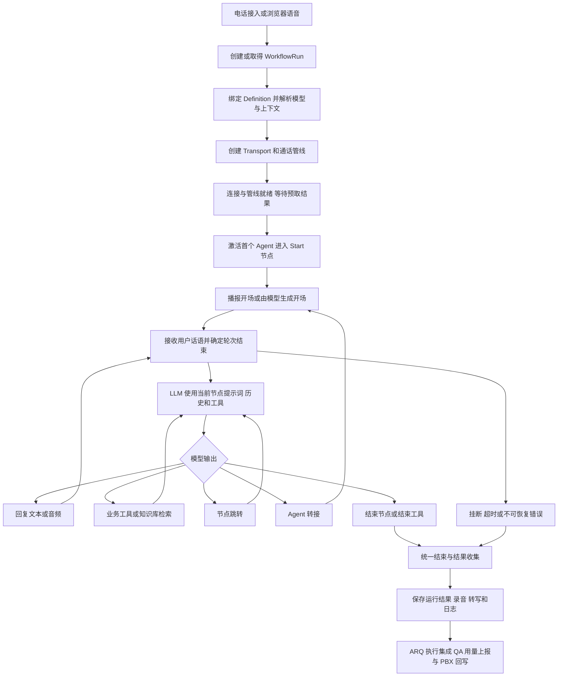
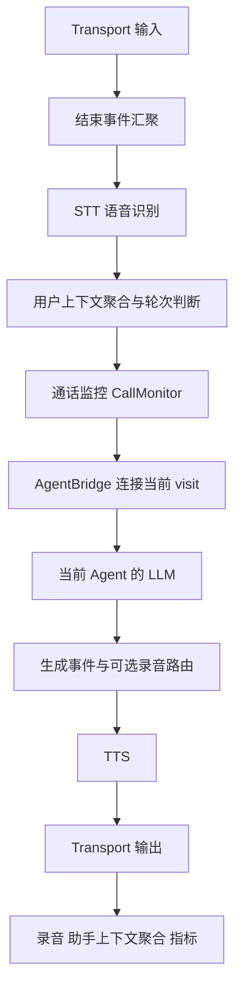

# Dograh 语音与对话 Agent 运行流程说明

本文说明 Dograh 中实际与用户通话或聊天的 Agent：从建立运行记录，到接收输入、决定回复、调用工具、切换节点或 Agent，再到结束和归档。适合你理解现有架构、定位运行问题，以及判断工作流配置如何影响真实对话。

配套文档：[Dograh Agent Workbench 处理流程与提示词说明](./agent-workbench-runtime.md)。

**核心机制：工作流定义业务边界，LLM 根据当前节点、历史对话和可用工具决定下一步，PipecatEngine 执行状态变化，Pipecat 管线负责实时输入输出。** 一次通话可以经过多个节点，也可以转交给多个 Agent，但仍由同一个通话级引擎管理。

代码基线：2026 年 10 月 22 日的本地工作区，HEAD 为 `eeccd89d`，包含当前未提交修改。这里描述的是该工作区实现；线上实例是否已部署同一版本需另行核对。

## 1 先分清四个对象

| 对象 | 作用 | 生命周期 |
| --- | --- | --- |
| Workflow 与 Definition | Workflow 是 Agent 的业务身份；Definition 保存某个版本的节点、连线、提示词与版本配置 | 配置和版本长期保存 |
| WorkflowRun | 一次实际执行的记录，绑定 definition_id，保存输入、结果、日志和用量 | 从本次创建到结束归档 |
| PipecatEngine | 通话级协调器，管理共享对话、业务结果、当前 Agent、播报与结束流程 | 持续整个语音通话 |
| AgentRuntime | 某次进入 Agent 的运行实例，持有工作流图、当前节点、模型、工具和 visit_id | 从激活到被转走或通话结束 |

同一个 Agent 可以在同一通话中被多次进入。例如 A → B → A 会产生三个不同的 `visit_id`，避免旧任务的迟到结果操作新的 Agent。

`PipelineWorker` 是 Pipecat 的异步管线执行单元。下文的通话 worker、Agent 子 worker，与处理通话后任务的 ARQ worker 属于不同层次。

## 2 从接入到结束的总流程

电话与浏览器的主要差别在接入、鉴权、音频格式和 Transport；它们最终进入同一个 `_run_pipeline_impl()`。文字聊天复用工作流引擎，但按轮创建短生命周期管线，详见第 11 节。

代码入口：[run_pipeline.py](../../api/services/pipecat/run_pipeline.py#L611)。

## 3 启动时具体做什么

### 3.1 接入并创建运行记录

浏览器测试先创建 WorkflowRun，再通过 WebSocket 交换 WebRTC 信令，音频由 WebRTC Transport 传输。电话路径通过对应供应商的呼入、外呼或媒体流接口接入；外部 Agent Stream 入口按 provider 路由到供应商实现。

入口负责相应的身份或接入校验、组织范围、配额及并发控制。进入统一管线后，还会核对 run 是否存在、是否属于所请求的 workflow、是否已经结束。

### 3.2 固定本次运行的版本

版本选择集中在 `definition_to_run()`：

- 正常运行优先使用 released definition，缺省时使用 current definition。

- 显式测试草稿时优先使用 draft；没有草稿则回退到线上定义。

- 显式指定版本时，只接受属于该工作流的 published 或 archived definition，不能同时指定 use_draft。

浏览器编辑器创建测试 run 时启用草稿与模板变量默认值。进入执行阶段后，工作流图读取 `workflow_run.definition`，不会每轮重新加载编辑器最新图。

固定 Definition 不代表冻结全部外部依赖：组织模型连接仍参与解析；当前语音代码中的背景音和上下文压缩开关也有从 Workflow 层读取的路径。

### 3.3 解析上下文与模型

普通业务输入的覆盖顺序是：创建 run 时的 initial_context → 启动时传入的上下文 → Start 节点的 pre-call fetch 结果。模板默认值仅在调用方显式启用时加入。

`workflow_run_id`、`call_id`、模型运行元数据等保留字段由运行系统控制，不能通过外部上下文任意覆盖。

模型选择基于组织的模型连接、版本中的模型覆盖配置，以及 run 相关配置。普通级联模式分别使用 STT、LLM 和 TTS；Realtime 模式使用语音到语音服务，并在需要时保留文本模型做变量提取等旁路推理。文本 LLM 可按已配置的 fallback 规则组合备用模型。

### 3.4 就绪后才开场

Start 节点可以按通话方向启用 pre-call fetch。请求会提前并行发出；若连接就绪时尚未返回，系统播放等待铃声。返回后先合并上下文，再完成首个 Agent 的模型初始化、激活和 Start 节点提示词渲染。

级联模式支持应用预取返回的受校验模型覆盖；Realtime 服务已在通话级创建，这一路径会忽略预取模型覆盖。只有 `pipeline_started` 和 `client_connected` 都成立，且通话未结束，系统才继续开场。

代码：[版本选择](../../api/services/workflow/run_creation.py#L23)、[测试 run 创建](../../api/routes/workflow.py#L1380)、[启动时序](../../api/services/pipecat/event_handlers.py#L180)。

## 4 语音管线如何分工

### 4.1 普通级联模式

STT 将语音转成文字，LLM 决定回复与工具调用，TTS 将回复转成声音。当前所有级联语音通话都采用“通话管线 + 每个 Agent visit 的生成子管线”。

其中 LLM、生成事件处理、可选录音路由、TTS 位于 Agent 子 worker。Transport、STT、共享上下文、录音、通话时钟与监控留在通话级。因此，转接 Agent 可以更换模型和业务流程，而保留现有连接与录音。

启用接听识别时，管线还会在用户聚合前加入识别处理，并在聚合后设置推理门控，协调接听判断与开场。

### 4.2 Realtime 模式

Realtime 服务直接消费音频并生成音频，管线不再插入独立的 STT/TTS。其核心顺序为：输入 → 用户聚合 → 通话监控 → Realtime 服务 → 生成事件处理 → 输出 → 录音与上下文、指标。

当前 Realtime 使用通话自身的 worker，不能在通话中执行 Agent 转接；转接工具会返回不可用结果，让当前 Agent 继续处理。Realtime 路径也关闭本地上下文压缩及此处的 voicemail detection。

代码：[管线组装](../../api/services/pipecat/pipeline_builder.py#L34)、[Agent 运行实例](../../api/services/workflow/agent_runtime.py#L76)。

## 5 一轮对话和节点切换如何发生

用户说完一句话后，聚合器将文字加入共享 `LLMContext`，再将上下文交给当前 Agent 的 LLM。一次用户轮次可以包含多次模型生成：例如先调用查询工具，拿到结果后再次生成回复。

模型每次可见的核心内容包括：

- 当前节点提示词，以及该节点允许叠加的全局提示词。

- 当前保留的历史消息和工具结果。

- 当前节点开放的知识库、业务工具和出边对应的跳转工具。

**连线的 condition 会成为跳转工具的描述，由模型根据对话判断是否调用。** 这部分没有把每条自然语言条件自动编译为确定性的 if/else。后端负责真正执行工具和状态变化，所以条件应明确描述完成标准、停止条件或异常分支。

一次正常节点迁移按下面顺序执行：

1. 模型调用当前节点某条出边对应的函数。

2. 按需触发离开节点的变量提取；语音模式通常在后台执行。

3. 有配置时先排队播放过渡文本或录音。

4. `set_node()` 核对发起请求的 visit，切换 current_node，记录访问节点并发送迁移事件。

5. 重新组合目标节点的 system prompt 和工具列表。工具列表为空时也会清除上一节点工具。

6. 工具返回值明确写入目标节点 ID、名称及“按当前节点要求回答”的指令。

7. 工具结果进入上下文后，触发后续生成。

进入 End 节点时，系统会跟踪结束回复的播报完成，再走统一结束入口。**节点已经切换、模型已经生成完、音频已经播完，是三个不同的时刻。**

例如“确认信息 → 查询订单 → 解释结果 → 结束”的业务流程中，用户说“好的”是否足以进入下一节点，取决于模型读取的节点要求和连线条件；如果条件写成含糊的“用户确认”，就可能过早推进。

代码：[提示词与工具组合](../../api/services/workflow/pipecat_engine_context_composer.py#L59)、[跳转执行](../../api/services/workflow/pipecat_engine.py#L428)、[set_node](../../api/services/workflow/pipecat_engine.py#L902)。

## 6 上下文和变量如何保存

| 数据 | 主要用途 | 需要注意 |
| --- | --- | --- |
| initial_context 与 _call_context_vars | 初始业务输入、模板替换、通话元数据 | 节点提示词通过这里渲染变量 |
| LLMContext.messages | 当前可用的用户、助手、工具消息 | 同一语音通话内共享；可能进行压缩或转接重组 |
| _gathered_context | 提取变量、访问节点、工具结果、结束原因及转接记录 | 最终写回 WorkflowRun，供结果展示和后处理 |
| 文本 checkpoint | 当前节点、消息、收集结果及状态字段 | 用于下一轮重建文字对话运行时 |

节点变量提取由独立管理逻辑调用推理模型，按节点声明的变量和提示词解析对话。结果只接受请求过的字段，并保护引擎自身拥有的结果字段；结束前还会按条件执行最终提取。

当前提取路径写入 `_gathered_context` 及其 `extracted_variables`。它不会自动把所有提取值合并进 `_call_context_vars`。因此，不能仅因为结果页出现了某个变量，就断言后续节点的同名模板占位符已经自动更新。

开启上下文压缩时，节点迁移可触发后台摘要；小上下文会跳过，摘要失败则保留原消息。Agent 转接带入的历史转写单独保留，不参与新 Agent 的普通节点摘要。Realtime 的会话状态由相应服务管理，不使用这条本地压缩路径。

代码：[变量提取](../../api/services/workflow/pipecat_engine.py#L645)、[上下文压缩](../../api/services/workflow/pipecat_engine_context_summarizer.py#L29)。

## 7 工具如何调用和收尾

工具按节点配置开放。主要包括 HTTP 业务工具、MCP 工具、知识库检索、计算器，以及结束通话、转电话和转 Agent 等控制工具。知识库节点注册检索工具，由模型调用获取资料后继续回答；不会默认把全部文档塞进每一轮提示词。

普通工具通过 `AgentRuntime.bind_tool()` 绑定到发起它的 visit，再由 `ToolExecutionOwner` 管理执行。系统以 tool_call_id 保存执行任务和结果，在该运行实例中避免重复启动同一个已接受的调用。

**打断语音并不等于撤销已经接受的业务工具。** 普通工具任务有独立所有者，即使管线等待者因打断或 Agent 退出而被取消，工具仍可在自己的超时范围内执行完，最终记录 visit_id、参数、状态和结果。只有仍然拥有通话的 Agent 才能把结果继续交给当前模型，旧 Agent 的结果不能驱动新节点。

节点迁移、结束、电话转接和 Agent 转接属于流程控制边界，按控制工具的顺序和取消规则处理。

默认普通工具执行上限为 10 秒；HTTP 工具默认取自身配置的 5000 毫秒，MCP 和电话转接也有各自超时。它们与通话监控的整体工具等待预算是两层限制。

代码：[工具注册与分类](../../api/services/workflow/pipecat_engine_custom_tools.py#L214)、[独立工具执行](../../api/services/workflow/tool_execution.py#L31)。

## 8 开场 打断 沉默和故障

### 8.1 开场与录音

`queue_node_opening()` 统一决定开场行为：有配置的文本开场走语音输出，有录音开场则播放录音；需要开场但没有固定内容时，请求 LLM 生成。录音获取失败可以回退到模型生成。恢复同一节点时可抑制重复开场。

级联开场有专门的打断与播放完成策略，完成的开场才进入相应助手上下文。Realtime 的文本开场交给语音模型生成，不能简单等同于逐字 TTS 播放。

在普通节点中，只有组织有录音且节点提示词包含相应录音标记时，录音路由才启用，模型输出可以选择预录音频或动态 TTS。

### 8.2 轮次与打断

系统区分“用户开始说话”和“用户说完”。级联模式支持最小词数、转写/VAD、供应商轮次事件等开始策略；结束策略可使用供应商事件、Smart Turn 或语音超时。当前默认开始策略为 min_words，默认阈值为 2，可由工作流配置调整。

普通节点的 `allow_interrupt=false` 会在 Agent 正在播报时屏蔽用户输入。过渡或工具提示音也可以临时要求屏蔽。开场和接听识别有专门规则，所以不能仅凭节点开关推断所有阶段的打断行为。

### 8.3 谁负责防止通话卡住

通话级 `CallMonitorProcessor` 统一判断此刻是在等用户、等模型、等工具，还是仍在播放回复。它在回复真正播放结束且没有工具续接后，才开始新的用户沉默计时。

| 监控项 | 当前代码默认值或规则 |
| --- | --- |
| 最大通话时长 | 300 秒；工作流可配置，从管线启动计时 |
| 用户沉默窗口 | 10 秒；工作流可配置，仅在适合等待用户时计时 |
| 连续沉默处理 | 第一次提醒；再次沉默触发结束 |
| 回复无有效音频进展 | 默认 35 秒预算 |
| 工具等待监控 | 默认 180 秒整体预算，工具本身仍受更短的独立超时限制 |
| 最终变量与结果提取 | 合计受 10 秒超时限制 |

当前 Agent 不可恢复的错误或回复看门狗超时会结束通话；看门狗不会盲目重放整轮业务请求，以免再次执行有副作用的工具。尚在准备或已经退出的 Agent 出错，不会直接当成当前通话的模型故障。

代码：[开场](../../api/services/workflow/pipecat_engine.py#L1041)、[打断与屏蔽](../../api/services/workflow/pipecat_engine.py#L1595)、[通话监控](../../api/services/pipecat/call_monitor_processor.py#L45)。

## 9 Agent 转接如何保持同一通电话

Agent 转接指在 Dograh 内把当前通话交给另一个 Workflow。电话转接工具连接外部电话或 PBX，是另一类动作。

级联 Agent 转接由引擎拥有的独立任务处理，一个时刻只接受一个请求：

1. **宣布转接**：需要时播报提示，整理来源 Agent 的已播消息。

2. **进入等待**：暂停来源 Agent，播放等待音，暂停对话级监控；通话总时长限制仍独立存在。

3. **准备目标**：在同一组织内查目标 Workflow，按本次通话的草稿/线上策略选择目标 Definition，创建新 visit、模型和工具。

4. **就绪检查**：目标 worker 启动并激活，但尚未取得通话输入输出的所有权。

5. **提交切换**：`commit_agent()` 同步更换当前 Agent、工具和对话历史，没有网络请求夹在提交中间。

6. **退出来源并开场**：回收旧 Agent，停止并排空等待音，恢复监控，按配置播报目标开场或继续对话。

目标接收一条标明来源的历史转写消息，内容来自当时可用的用户和助手对话，并包含准备期间新增的话语。旧 system prompt、工具调用结构、工具返回值及供应商私有消息格式不会作为原有消息结构直接带入。若此前已做摘要，交接材料包含现有摘要，而不是重新恢复已压缩的原始消息。

准备阶段默认最多 20 秒，目标激活等待默认 5 秒。提交前失败时，系统清理目标并尝试恢复来源 Agent，让它继续服务；提交后错误不会按同一方式回滚旧 Agent。实时输出、节点操作和工具结果均按 visit 归属过滤。

转接始终保留原 WorkflowRun。结束时，`agent_visits` 和转接结果记录补充实际经历的 Agent、版本和运行模型。

代码：[转接协调器](../../api/services/workflow/agent_transfer.py#L124)、[同步提交](../../api/services/workflow/pipecat_engine.py#L1814)、[历史交接](../../api/services/workflow/agent_handoff_context.py#L1)。

## 10 通话如何结束和归档

结束可能来自 End 节点、结束工具、用户挂断、沉默超时、总时长限制或不可恢复的管线错误。正常 End 节点会等待结束回复播放；立即中止的错误路径则优先关闭通话。

`end_call_with_reason()` 为通话创建单一的 shutdown task，防止多个结束信号并发重复收尾。主要顺序为：

1. 标记通话 disposed，屏蔽新输入，停止播报跟踪，取消失效的流程控制与待完成转接。

2. 等待已接受的普通工具按各自超时收尾并记录结果。

3. 写入实际结束机制 call_status，并保留已确定的业务 disposition；没有业务结果时先用结束机制兜底。

4. 按条件完成变量提取及业务结果分类；受超时限制，失败时保留已有结果。

5. 先回收 Agent 子 worker，收集 visit 信息，再向通话 worker 发 EndFrame 或 CancelFrame。

6. 管线完成回调排空观察器与转写队列，保存 gathered_context、用量、日志及 completed 状态，并通知关联 campaign。

7. 从进程内缓冲上传录音和转写，然后入队通话后处理任务。录音上传受开关控制；上传失败会记录错误，后处理仍可能继续。

8. ARQ 按顺序执行通话后集成及 QA、平台用量上报、外部 PBX 回写，各步骤分别记录失败。

运行状态主要是 `initialized → running → completed`。**completed 表示运行生命周期结束，不等于业务成功。** 应同时查看：

| 字段 | 回答的问题 |
| --- | --- |
| state / is_completed | 运行是否已经结束 |
| call_status | 实际因为什么机制结束 |
| call_disposition | 最终业务结果是什么 |
| mapped_call_disposition | 组织映射后的结果编码 |
| extracted_variables / tool results | 识别到什么信息、工具实际做了什么 |
| agent_visits / transfer outcomes | 谁参与了对话、转接是否成功 |

主要证据包括节点迁移、用户与助手转写、工具结果、延迟与用量，以及配置启用时的 trace 和通话事件。排查某次通话时应从该 run 绑定的历史 Definition 出发。

代码：[统一结束入口](../../api/services/workflow/pipecat_engine.py#L1304)、[完成与归档](../../api/services/pipecat/event_handlers.py#L385)、[ARQ 后处理](../../api/tasks/workflow_completion.py#L13)。

## 11 文字聊天如何复用同一套逻辑

文字聊天使用同一个 WorkflowGraph 和 PipecatEngine，复用节点提示词、工具、节点迁移、变量提取和结束语义；它不经过麦克风、STT、TTS 或真实音频 Transport。

每一轮的过程为：取得 pending turn → 加载固定 Definition 和 checkpoint → 创建本轮 LLM 与短管线 → 恢复消息和当前节点 → 运行开场或用户消息 → 等待本轮模型和工具活动结束 → 关闭本轮管线 → 保存新 checkpoint。

checkpoint 包含 current_node_id、messages、gathered_context 等状态。每轮管线关闭只是资源回收，只有引擎把会话标记为 disposed 时，业务会话才算结束。

Start 节点预取只在首次节点开场前执行，并持久化其上下文及相关模型设置，后续轮次复用。与语音模式不同，文字模式在节点跳转前同步等待变量提取，避免短管线销毁时丢失提取结果。

Workbench 文本仿真也调用这条真实文字执行路径，但启用服务端 evaluation policy，以夹具控制外部副作用；这与普通用户文字会话的运行权限不同。

代码：[文字轮次执行](../../api/services/workflow/text_chat_runner.py#L485)。

## 12 读代码和排查问题的顺序

| 你观察到的现象 | 优先核对 |
| --- | --- |
| 连上后一直没有开场 | 连接与管线是否都就绪、预取是否返回、首个 Agent 是否激活、开场播放结果 |
| 提前跳节点或走错分支 | 该 run 的 Definition、当前节点提示词、实际暴露的跳转工具描述、迁移日志和工具结果 |
| 变量提取成功但下一节点仍为空 | 提取写入 gathered_context，模板是否实际读取到 call_context_vars 中的值 |
| 用户打断后外部操作仍发生 | 工具是否已被接受；检查 tool_call_id、visit_id 和独立执行记录 |
| 模型已有文字但听不到声音 | TTS、录音路由、Transport 输出、实际音频进展与播报完成事件 |
| Agent 转接失败 | 当前是否 Realtime、目标组织/版本/模型是否可用、准备或激活阶段结果 |
| completed 但结果异常 | call_status、业务 disposition、失败日志，而不只看运行状态 |
| 结束后暂时没有录音或 QA | 产物上传结果及 ARQ 后处理进度；运行结束与后处理完成是不同时间点 |

建议阅读顺序是：[统一运行入口](../../api/services/pipecat/run_pipeline.py#L611) → [管线组装](../../api/services/pipecat/pipeline_builder.py#L34) → [节点迁移](../../api/services/workflow/pipecat_engine.py#L428) → [AgentRuntime](../../api/services/workflow/agent_runtime.py#L76) → [工具执行](../../api/services/workflow/tool_execution.py#L31) → [转接](../../api/services/workflow/agent_transfer.py#L124) → [结束归档](../../api/services/pipecat/event_handlers.py#L385)。

现有相关测试可辅助理解边界行为：[节点上下文更新](../../api/tests/test_pipecat_engine_context_update.py)、[Agent 转接](../../api/tests/test_agent_transfer.py)、[历史交接](../../api/tests/test_agent_handoff_context.py)、[通话监控](../../api/tests/test_call_monitor.py)、[文字聊天](../../api/tests/test_workflow_text_chat.py)。
